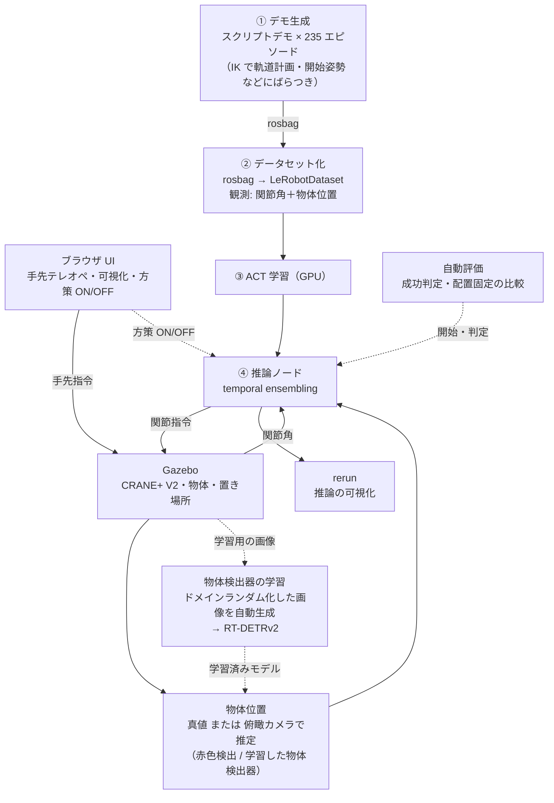

# CRANE+ V2 把持・配置タスクの模倣学習（Physical AI 2026 最終課題）

テーブル上の**ランダムな位置にある物体を掴み、所定の位置に置く**タスクを、Gazebo 上の CRANE+ V2 と模倣学習（ACT）で解きます。
最終作品サンプルの[「知能ロボットシステムエンジニアリング 第5回 ROS 2入門（2/2）」](https://skinny-chord-c58.notion.site/5-ROS-2-2-2-2049a7a1061380fc8928e500eafc57d0)（以下、サンプル。関節キーボードでテレオペ → rosbag → LeRobotDataset → ACT → Gazebo で自律実行）をベースに、
操作・観測・評価の各段階を改良しました。

## 結果
Gazebo 上での自律実行の成功率（改良版は物体の配置を固定した同じ 30 か所で比較）:

| モデル | 物体位置の入力 | ホームから開始 | 開始姿勢を ±3cm ずらす |
|---|---|---|---|
| ベースライン（サンプルと同じ観測） | なし（関節角のみ） | 10%（20 試行） | - |
| 改良版（固定開始のデモのみ） | 真値 | 100%（30/30） | 30%（9/30） |
| **最終版（開始姿勢をばらつかせたデモを追加）** | 真値 | **100%**（30/30） | **100%**（30/30） |
| **最終版** | **俯瞰カメラから推定**（赤色検出） | **100%**（30/30） | **97%**（29/30） |

物体の色・照明・机・ダミー物体を毎回変えたシーン（同じ 30 か所, 最終版の方策）:

| 物体位置の推定 | 成功率 |
|---|---|
| 赤色検出 | 3%（1/30） |
| **学習した物体検出器（RT-DETRv2）** | **100%**（30/30） |

詳細な実験記録（学習量・データ量・temporal ensembling・観測劣化への頑健性・失敗原因の分析・開始姿勢への頑健性）は
[docs/design/training_eval/training_eval.md](docs/design/training_eval/training_eval.md)、物体検出器は
[docs/design/perception/detector.md](docs/design/perception/detector.md) を参照してください。

## サンプルからの主な改良
| サンプルの弱点 | 改良 |
|---|---|
| 関節空間のキーボード操作が直感的でない | ブラウザ UI（rosbridge）で手先の xyz・pitch を操作し、解析的逆運動学で関節角に変換。動作確認・方策の ON/OFF にも使用 |
| デモを人手で集めるため、条件を揃えた比較実験がしにくい | 物体位置から IK で軌道を計画する**スクリプトデモ**で学習データを自動生成（速度・経由高さ・把持位置・**開始姿勢**にばらつきを付与、seed で再現可能）。テレオペと同じ経路（手先指令 → IK → 関節指令）で収録 |
| 毎回同じ姿勢から始めることを前提にした方策 | 開始姿勢が 1cm ずれるだけで成功率が 50% に落ちる弱点を評価で発見し、開始姿勢をばらつかせたデモを加えて解消（±3cm でも 100%） |
| 毎回同じ動作で、観測が関節角のみ | 物体位置をエピソードごとにランダム化し、観測に物体位置を追加 |
| 物体位置が既知の前提 | 俯瞰カメラの画像から物体位置を推定し、真値なしで自律実行 |
| 赤い物体・一定の照明でしか物体を見つけられない | 物体色・照明・机・ダミー物体をランダムに変えた Gazebo 画像（自動ラベル付き）で物体検出器 RT-DETRv2（Apache-2.0）を学習。見た目を変えたシーンで成功率 3% → 100%（[詳細](docs/design/perception/detector.md)） |
| 学習・推論が CPU 前提 | Docker に GPU を渡して学習・推論（RTX 4090 で約 50ms/step、60k step で約 1 時間） |
| 評価が目視・オフライン比較のみ | 成功判定・自動評価（Wilson 信頼区間、配置固定の比較）、rerun での推論の可視化、rosbag による失敗解析 |
| 行動チャンクの先頭だけを実行 | ACT の temporal ensembling で実行時の誤差の蓄積を抑制（成功率 55% → 100%） |

## 構成


| ディレクトリ | 内容 |
|---|---|
| [ros2_ws/src/crane_plus_kinematics](ros2_ws/src/crane_plus_kinematics) | CRANE+ V2 の順運動学・解析的逆運動学（ROS 非依存） |
| [ros2_ws/src/pai_web_teleop](ros2_ws/src/pai_web_teleop) | ブラウザ手先テレオペ・録画・方策の ON/OFF |
| [ros2_ws/src/pai_task_env](ros2_ws/src/pai_task_env) | タスク環境（world・ランダム配置・成功判定・把持アシスト・赤色検出・スクリプトデモ・評価・検出器の学習データ生成とシーンのランダム化） |
| [external/pai_training](https://github.com/ryota0051/pai_training/tree/feature/pick-place) | サンプルの学習リポジトリの fork（submodule）。変換・ACT の学習・推論・解析、物体検出器の学習・評価・推論ノード |
| [docker](docker) | 開発用 Docker（GPU）環境 |
| [scripts/sim](scripts/sim) | シミュレーション起動・評価・撮影用のスクリプト |
| [scripts/report](scripts/report), [scripts/video](scripts/video) | 説明資料（PDF）のグラフ生成・PDF 化、提出動画の録画・編集 |
| [docs](docs) | 設計書（[docs/design](docs/design/index.md)）、設計判断（[docs/decision](docs/decision/index.md)）、作業ログ、説明資料と動画の構成（[docs/report](docs/report)） |

## 動かし方
前提: Docker（NVIDIA GPU を使う場合は NVIDIA Container Toolkit / Docker Desktop の GPU 対応）。

```bash
git clone --recursive https://github.com/ryota0051/pai-final-task-pick-place.git
cd pai-final-task-pick-place/docker
cp .env.example .env
docker compose up -d --build
docker exec -it -u ubuntu pai_final_task bash      # 以降はコンテナ内
cd ~/pai_training && pixi install                    # 初回のみ
~/final_task/scripts/sim/start_stack.sh              # ビルド + Gazebo + タスク環境 + テレオペ UI を起動
```
- Gazebo の画面: http://localhost:6080 （noVNC）
- テレオペ UI: http://localhost:8080
- 推論の可視化（rerun。推論ノードの起動後）: <http://localhost:9877/?url=rerun%2Bhttp%3A%2F%2Flocalhost%3A9876%2Fproxy>（`?url=` 以降も必要。`http://localhost:9877` だけだと rerun の紹介画面になる）

### デモの収集
- スクリプトデモ（IK で計画した軌道。**学習データは全てこれで生成**。固定開始 117 ＋ 開始姿勢ばらつき 118 の計 235 エピソード）:
  ```bash
  cd ~/final_task/ros2_ws
  ros2 run pai_task_env scripted_demo --ros-args --params-file src/pai_task_env/config/scripted_demo.yaml -p episodes:=40 -p seed:=0   # 回数・seed は例
  # 開始姿勢をばらつかせる（録画先を分けるため、スタックは recorder_startrand.yaml で起動: docs/design/task_env を参照）
  ros2 run pai_task_env scripted_demo --ros-args --params-file src/pai_task_env/config/scripted_demo.yaml -p episodes:=125 -p seed:=1 \
    -p "randomize.start_offset:=[0.03,0.03,0.02]"
  ```
- 人のテレオペ（ブラウザ UI）: 「タスクリセット」→「録画開始」→ 物体を掴んで置き場所へ →「録画停止」（学習には未使用）

### 変換・学習・推論・評価（`~/pai_training`）
```bash
pixi run --frozen convert --config configs/pick/conversion_objpos_startrand.yaml --overwrite   # rosbag（2 ディレクトリ）→ LeRobotDataset
pixi run --frozen train --config configs/pick/train_objpos_startrand.yaml                      # ACT 学習（GPU, 60k step で約 1 時間）
pixi run --frozen infer --config configs/pick/infer_objpos_startrand.yaml                      # 推論ノード（物体位置は真値）
pixi run --frozen infer --config configs/pick/infer_objpos_startrand_camera.yaml               # 推論ノード（俯瞰カメラで推定した物体位置）
pixi run --frozen check-dataset --dataset-root ~/dataset/lerobot_dataset/crane_plus_pick_objpos_startrand --split 117   # 変換したデータの検査
```
変換したデータセットを rerun で目で確認する手順は [docs/design/dataset/conversion.md](docs/design/dataset/conversion.md) を参照してください。
推論ノードの起動後、テレオペ UI（<http://localhost:8080>）で「タスクリセット」→ 腕が止まったら「方策 ON」で自律実行します（手順と注意点は [docs/design/web_teleop/web_teleop.md](docs/design/web_teleop/web_teleop.md#ブラウザ-ui-で学習済みモデルを動かす自律実行)）。

自動評価（物体配置を固定して真値 / カメラ推定を比較）:
```bash
bash ~/final_task/scripts/sim/eval_paired.sh 0 30 truth:configs/pick/infer_objpos_startrand.yaml camera:configs/pick/infer_objpos_startrand_camera.yaml
# 開始姿勢をずらす場合
EVAL_ARGS="-p start.offset:=[0.03,0.03,0.02]" bash ~/final_task/scripts/sim/eval_paired.sh 0 30 truth:configs/pick/infer_objpos_startrand.yaml
```
結果は `~/dataset/eval/` に CSV と成功率のサマリ（JSON）で出力されます。

### 学習した物体検出器（[詳細](docs/design/perception/detector.md)）
```bash
# 学習データの生成（Gazebo でシーンをランダム化して撮影し、正解の枠を自動で付ける。1 枚約 5.6 秒）
cd ~/final_task/ros2_ws
ros2 run pai_task_env dr_dataset_generator --ros-args --params-file src/pai_task_env/config/domain_randomization.yaml -p images:=1200
ros2 run pai_task_env dr_dataset_generator --ros-args --params-file src/pai_task_env/config/domain_randomization.yaml   -p images:=300 -p seed:=1 -p output_dir:=~/dataset/detector/dr_test      # 評価用（別の seed）
# 学習・評価（~/pai_training）
pixi run --frozen train-detector --config configs/detection/train_rtdetr.yaml   # RTX 4090 で約 13 分
pixi run --frozen eval-detector --config configs/detection/eval_rtdetr.yaml     # 位置誤差を赤色検出と比較
# 方策で使う: 赤色検出を止めて起動し、検出ノードを動かす（出力は赤色検出と同じ /task/object_pose_est）
TASK_ENV_ARGS="red_detector:=false" ~/final_task/scripts/sim/start_stack.sh
pixi run --frozen detect-node --config configs/detection/detect_rtdetr.yaml &
pixi run --frozen infer --config configs/pick/infer_objpos_startrand_camera.yaml
# 見た目を毎回変えて評価する
EVAL_ARGS="-p scene_randomization.enabled:=true" bash ~/final_task/scripts/sim/eval_paired.sh 0 30 learned:configs/pick/infer_objpos_startrand_camera.yaml
```

### 説明資料（PDF）・動画
- 説明資料: `docs/report/report.md` を編集し、ホストで `uv run --group report python scripts/report/make_figures.py` と
  `uv run --group report python scripts/report/build_report.py`（Chrome / Edge で PDF 化。出力は `docs/report/build/`）
- 動画: 構成は `docs/report/video.yaml`。コンテナ内で `python3 ~/final_task/scripts/video/record_clips.py`（Gazebo の画面を録画）、
  `python3 ~/final_task/scripts/video/compose.py`（字幕・倍速表示を付けて編集）

### テスト
```bash
cd ~/final_task/ros2_ws/src && python3 -m pytest -q crane_plus_kinematics pai_task_env pai_web_teleop   # ROS パッケージ
cd ~/pai_training && pixi run --frozen test
node --test ros2_ws/src/pai_web_teleop/test/js/gamepad.test.js ros2_ws/src/pai_web_teleop/test/js/keys.test.js   # ブラウザ UI のキー・ゲームパッド入力（ホストのリポジトリ直下で実行）
```

## 注意
- 最終モデルの学習データはスクリプトデモのみです。ブラウザ UI で収録した人手デモ 21 本では、人手のみで成功率 0%、スクリプトデモに混ぜると 100% → 80% に下がりました（掴む前に止まって位置を合わせる時間が回ごとにばらばらで、方策が下ろす判断をできない。詳細は [training_eval.md](docs/design/training_eval/training_eval.md) の実験10・11、説明資料 4.9）。
- 物体検出器はシミュレーション画像だけで学習しており、実機の画像での動作は確認していません。既定の起動では赤色検出が動きます（切り替えは上記）。
- 物体の把持には、Gazebo で摩擦による把持が滑り落ちる問題への対策として、グリッパが閉じて物体が近いときに手先へ固定する把持アシストを使っています（[ADR 0006](docs/decision/0006-把持アシスト.md)）。
- 学習データ・学習済みモデル・動画（`data/`）は容量が大きいためリポジトリに含めていません。上記の手順で生成できます。
- ベースイメージはサンプルで使われているイメージ（`airobotbook/ros2-desktop-ai-robot-book-humble`）、学習はサンプルの [pai_training](https://github.com/matsuolab/pai_training) を fork して拡張しています。
