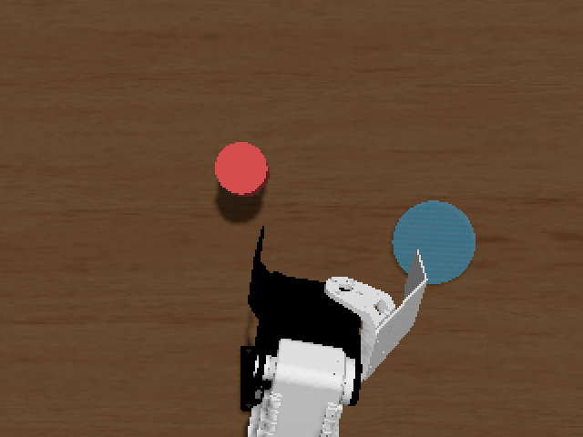

# 把持・配置タスク環境仕様

パッケージ: `ros2_ws/src/pai_task_env`（設定: `config/task.yaml`）

## 起動
```bash
ros2 launch pai_task_env task_env.launch.py          # Gazebo + CRANE+ + 物体 + task_manager_node
ros2 launch pai_task_env task_env.launch.py randomize_place:=true   # 置き場所もエピソードごとに変える（実験12, ADR 0009）
ros2 launch pai_web_teleop web_teleop.launch.py      # テレオペ UI（別ターミナル）
```
演習イメージの `crane_plus_with_table.launch.py` は world が `table.sdf` 固定のため、同等構成（ign gazebo / spawn / spawner / clock bridge）を
`task_env.launch.py` で組み直している。MoveIt・RViz は起動しない。

## world（`worlds/pick_place.sdf`）
- `table.sdf` と同じ Sun / Ground Plane / Table（Fuel）。テーブル上面 = ロボット基準 z≈0（ロボットは world z=1.015 にスポーン）
- `target_cube`: **直径 4cm・高さ 4cm の円柱**、0.03kg、mu=2.0。OdometryPublisher で world 姿勢を `/model/target_cube/odometry` に publish
  - 当初は 4cm 立方体だったが、手首ヨーの無い 4 軸アームでは base のヨー角で接近するため、世界軸に揃った立方体を対角で挟んでしまい把持できなかった（ヨー 0.6rad 以上で失敗）。向きに依らない円柱に変更
- `place_zone`: 半径 3.5cm の可視マーカー（衝突なし・static）
- 物体・置き場所の位置の正は `task.yaml`。起動時とリセット時に `ign service /world/default/set_pose` で上書きする
  （置き場所は既定では固定。`randomize_place:=true` でリセットごとにサンプルする）

## 座標系
観測・成功判定はすべて `crane_plus_base` 基準。world→base は `base_origin: [0, 0, 1.015]`, `base_yaw` で変換（`frames.BaseFrame`）。

## task_manager_node
| I/F | 名前 | 型 | 内容 |
|---|---|---|---|
| sub | `/task/object_odom` | nav_msgs/Odometry | ros_gz_bridge 経由の物体 world 姿勢 |
| sub | `/joint_states` | JointState | 把持中心（FK）と手先関節角 |
| pub | `/task/object_pose` | PoseStamped | 物体姿勢（crane_plus_base）。**学習の観測に使用** |
| pub | `/task/place_pose` | PoseStamped | 置き場所（ランダム化時はリセットごとに変わる）。置き場所を観測に使うモデルの入力 |
| pub | `/task/status` | String(JSON) | lifted, in_place_zone, success, grasped, episode, object, place |
| pub | `/task/success` | Bool | 成功フラグ |
| pub | `/task/gz/attach`, `/task/gz/detach` | Empty | 把持アシスト（bridge で Gazebo へ） |
| srv | `/task/reset` | Trigger | 物体位置（と置き場所）を再サンプル（detach → set_pose）、成功判定リセット |
| sub | `/task/reset_to` | Point | 評価用: 物体を指定位置に置いてリセット（置き場所は固定位置） |
| sub | `/task/reset_to_scene` | Float64MultiArray | 評価用: [物体 x, y, 置き場所 x, y] に置いてリセット |

### 物体位置サンプリング（`sampler.ObjectSampler`）
x/y 範囲から一様サンプルし、水平半径範囲 `r`（真下向き把持で IK 可能な範囲）と置き場所からの最小距離で棄却。`seed>=0` で再現可能。

### 置き場所のランダム化（`sampler.PlaceSampler` / `sample_scene`, ADR 0009）
- `place.randomize: true` または launch 引数 `randomize_place:=true` で有効（既定は固定 `place.xy`）
  - launch 引数は別名のパラメータ `randomize_place` で渡す。ノード名指定のパラメータファイルはワイルドカード指定より優先されるため、
    launch から `place.randomize` を上書きしても効かない
- 置き場所を先に `place.sampler`（x: 0.04〜0.16, y: ±0.14, r: 0.09〜0.165）から引き、物体はそこから `min_dist_from_place` 以上離す
- 置き場所の範囲は物体と同じ半径帯。0.5cm 間隔の 932 点すべてで、置く高さ 0.015〜0.035・運ぶ高さ 0.07〜0.09（pitch 65°）の IK が解ける
- 成功判定の置き場所はリセットごとに `SuccessTracker.set_place` で更新する
- 評価器（`policy_evaluator`）は `randomize_place:=true` で (物体 x, y, 置き場所 x, y) の固定リストを生成し、`/task/reset_to_scene` で置き直す

### 成功判定（`success_checker.SuccessTracker`）
- pick: 物体が一度 `lift_height` 以上持ち上がり、その後置き場所半径内・テーブル上（z 許容差内）に `hold_time` 連続で静置
- reach（フォールバック）: 手先が物体に `reach_threshold` 以内で `hold_time` 連続

### 把持アシスト（`grasp_assist.GraspAssist`, ADR 0006）
ロボット記述をラッパー xacro（`urdf/crane_plus_task.urdf.xacro`）で読み込み、link4–物体間の DetachableJoint を追加。
グリッパ関節角 ≥ `close_threshold` かつ 把持中心と物体中心が `attach_distance` 以内で attach、関節角 ≤ `open_threshold` で detach。

## グリッパ幾何（メッシュから算出, 2026-10-10）
| 項目 | 値 |
|---|---|
| 固定爪 内面 | link4 y = 0.037、z = 0.074〜0.120 |
| 可動指 | hand 関節（link4 (0, -0.0145, 0.045)、-x 軸回り）。閉じると +y 方向へ |
| 爪間隔 | q=0.17: 4.1cm / q=0.30: 3.0cm / q=0.40: 2.1cm |
| 可動指先端の深さ | 閉動作中に最深 約 0.138（link4 z） |

→ 直径 4cm 円柱、把持中心 `tool_length=0.125`, `tool_offset_y=0.017`、グリッパ閉指令 0.30rad を採用。

## 手先 pitch の選定
サンプリング範囲 301 点で「把持高さ 0.02 と接近高さ 0.06〜0.08 の両方が IK 可能」な割合を pitch ごとに算出した。

| pitch | z=0.02 & 0.06 | z=0.02 & 0.08 |
|---|---|---|
| 90°（真下） | 0/301 | 0/301 |
| 75° | 301/301 | 77/301 |
| 65° | 301/301 | 301/301 |
| 50° | 258/301 | 258/301 |

→ スクリプトデモ・テレオペのホームとも **65°（1.134rad）** を既定とする。真下向きだと接近時に pitch 緩和で姿勢が大きく変わり、把持タイミングに腕が追従できず失敗していた。

## スクリプトデモ（`scripted_demo`, 設定: `config/scripted_demo.yaml`）
パイプライン検証とデモデータ生成用。1 エピソードは
`/teleop/home` → `/task/reset` → `/recorder/start` → 計画実行 → `/recorder/stop` →（失敗なら `/recorder/discard_last`）。
- 計画（`scripted_policy.PickPlacePlan`）: start → approach → descend → grasp → lift → carry → lower → release → retreat。位置は min-jerk 補間、区間時間は距離/速度（下限あり）
- 多様性: 速度倍率・経由高さ・把持/配置位置にランダムな揺らぎ（`randomize`）
- 開始姿勢のばらつき（`randomize.start_offset`, 既定 0 で無効）: ホーム後・収録前に手先を各軸 ±offset の一様乱数だけずらして止め、そこから計画する。
  方策が静止したホーム姿勢からの開始に依存する問題（training_eval の実験8）への対策。ずらした分の移動は収録しない
- テレオペと同じ `/teleop/ee_target`・`/teleop/gripper` を 20Hz で publish するので、収録されるトピックは人のテレオペと同一

```bash
ros2 run pai_task_env scripted_demo --ros-args --params-file src/pai_task_env/config/scripted_demo.yaml -p episodes:=40 -p seed:=0
# 開始姿勢をばらつかせたデモ（録画先を分けるため、スタックは recorder_startrand.yaml で起動しておく）
ros2 run pai_task_env scripted_demo --ros-args --params-file src/pai_task_env/config/scripted_demo.yaml -p episodes:=125 -p seed:=1   -p "randomize.start_offset:=[0.03,0.03,0.02]"
```

## 動作確認（2026-10-10）
- スクリプトデモ（pitch 65°）で 8/8 成功（`/task/reset` によるランダム配置込み）

## カメラによる物体位置推定（object_detector_node, 設定: `config/camera.yaml`）
物体位置の真値（`/task/object_pose`）は実機では得られないため、俯瞰カメラから推定した `/task/object_pose_est` を用意した。

- world に固定の俯瞰カメラ（crane_plus_base 基準 (0.12, 0, 0.45)、真下向き、320×240、hfov 1.0rad、10Hz）を追加
- 赤色画素（R ≥ 120 かつ G, B ≤ 0.5R）の重心 → ピンホールモデルで円柱上面の高さ（z=0.04）の平面へ逆投影 → 物体中心高さ 0.02 として出力
- 遮蔽で見えないときは最後の推定値を保持（`hold_last`）。検出状態は `/task/detector_status`
- カメラ設定と world SDF の一致、作業範囲が画角内に入ることを `test_camera_config.py` で検証



### 動作確認（2026-10-10）
| 項目 | 結果 |
|---|---|
| 画像レート | 約 9Hz（設定 10Hz） |
| シミュレーション実時間比 | 0.91（GPU 学習を並行実行中。カメラなしは約 1.0） |
| 推定誤差（ランダム配置 3 回） | 約 1.5mm 以下 |

## 操作時間の計測（`episode_timer`）
テレオペ方式（ブラウザ手先 UI / 演習の関節キーボード）の操作時間を比べるためのノード。
指令ではなく関節の動きで開始を判定するので、操作方式によらず同じ基準で測れる（`pai_task_env/episode_timer.py`）。
```bash
ros2 run pai_task_env episode_timer --ros-args --params-file ~/final_task/ros2_ws/src/pai_task_env/config/episode_timer.yaml -p label:=browser
```
- エピソード（`/task/status` の `episode`）ごとに、リセット時の姿勢から関節が `motion_threshold` 以上動いた時刻〜成功までを
  `~/dataset/teleop_time/<label>.csv`（label, episode, idle, duration）に追記する
- 関節キーボード（`ros2 run physicalai_teleop teleop_keyboard`）で計測するときは、ブラウザ側のテレオペを無効にする
  （`ee_teleop_node` は有効な間ずっと指令を出し続けるため）: `ros2 service call /teleop/enable std_srvs/srv/SetBool "{data: false}"`

## 撮影用カメラ（動画・レポート素材用）
> **注意**: コンテナ内の Gazebo はソフトウェア描画（llvmpipe）のため、カメラセンサーを 1 台追加するだけでシミュレーションが 0.04 倍速まで遅くなる（解像度を下げても同程度）。
> 推論ノードやスクリプトデモは壁時計で動くので、追加したまま動かすと失敗する。**静止画の撮影専用**とし、動画は Gazebo GUI の画面録画（`scripts/video/record_clips.py`, `scripts/sim/gui_view.sh`）で撮る。

実験には使わない撮影専用のカメラ（`models/presentation_camera.sdf`, 1280×720, 20Hz）を、撮影時だけ Gazebo のサービスで world に追加する。
GUI 画面のキャプチャと違い、構図が再現でき、画面上の表示物に左右されない。
```bash
bash ~/final_task/scripts/sim/presentation_camera.sh add [x y z 注視x 注視y 注視z]   # world 座標。既定は斜め前方から全体を写す
ros2 run pai_task_env frame_recorder --ros-args -p output:=~/dataset/media/scene.png -p snapshot:=true   # 静止画
ros2 run pai_task_env frame_recorder --ros-args -p output:=~/dataset/media/run.mp4 -p duration:=20.0     # 動画
bash ~/final_task/scripts/sim/presentation_camera.sh remove
```
- 画像は `/task/presentation/image`（ros_gz_bridge で中継）。動画は `FrameRateLimiter`（`pai_task_env/frame_recorder.py`）で目標 fps に間引いて書き出す
