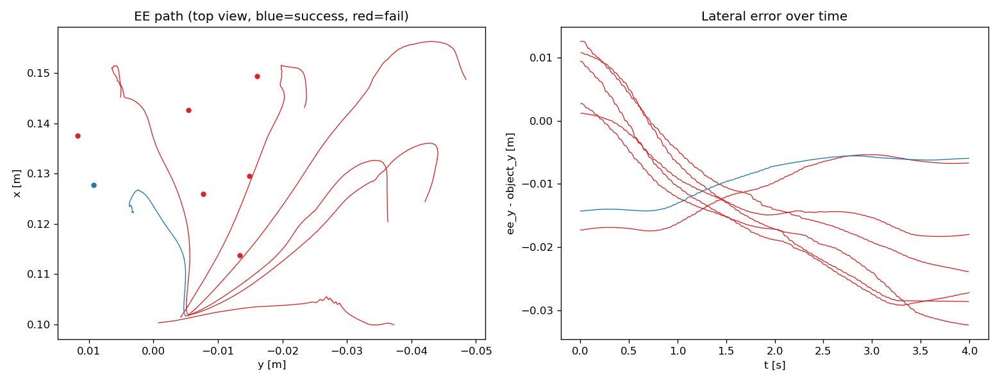
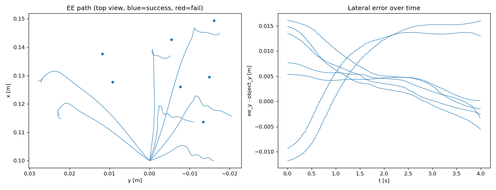
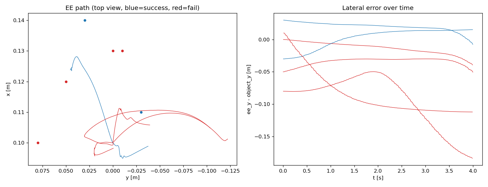

# 学習・推論・評価仕様

## 学習（`external/pai_training/scripts/train.py`）
```bash
pixi run --frozen train --config configs/pick/train_objpos.yaml            # GPU（device: cuda）
pixi run --frozen train --config configs/pick/train_objpos.yaml --device cpu --steps 500 --output /tmp/cpu_bench
```
- 追加設定: `wandb_mode`（既定 disabled）, `seed`, `episodes`, `weight_decay`, `act`（ACTConfig 追加引数）
- 学習時間・ms/step・最終 loss を `<output_directory>/train_info.json` に保存（CPU/GPU 比較用）
- 観測は `delta_timestamps` にある `observation.*` をすべて最新の 1 時刻に絞って ACT に渡す（状態・カメラ画像とも）
- カメラ画像を使うモデルは、画像の backbone（ImageNet 学習済み ResNet18）だけ学習率を `act.optimizer_lr_backbone`（既定 1e-5）にする（`policy.get_optim_params()`。ACT 論文・LeRobot と同じ。ADR 0011）
- `delta_timestamps.action` は 20fps に合わせ 0.0〜0.75s の 16 ステップ。演習設定は -0.1s 始まりで、`n_action_steps: 1` だと実行される行動が 0.1s 前のものになっていた

## 推論（`scripts/infer.py`）
```bash
source /opt/ros/humble/setup.bash
pixi run --frozen infer --config configs/pick/infer_objpos.yaml
```
| I/F | 名前 | 内容 |
|---|---|---|
| sub | `/joint_states`, `/task/object_pose` | 観測（`conversion_config` と同じ規則で組み立て = 学習時と一致） |
| sub | 変換設定の `topics.<カメラ名>`（例 `/task/camera/image`） | カメラ画像を使うモデルのみ。最新の画像を (3, H, W) float [0, 1] にして渡す（rerun にも表示） |
| pub | arm / gripper の joint_trajectory | 予測チャンクの先頭（または temporal ensembling） |
| pub | `/policy/status` | enabled, ready, step, latency_ms, predicted, device（ブラウザ UI に表示） |
| srv | `/policy/enable` (SetBool) | 有効化時に `policy.reset()` |
| srv | `/policy/reset` (Trigger) | |
| rerun | web 9877 / gRPC 9876（ブラウザで `http://localhost:9877/?url=rerun%2Bhttp%3A%2F%2Flocalhost%3A9876%2Fproxy`） | 実関節角・指令・予測チャンク・物体位置・レイテンシ |

`start_enabled: false` のため、ブラウザ UI の「方策 ON」（テレオペを無効化して方策を有効化）か評価スクリプトから開始する。

トピックは「既定 → 変換設定の `topics`（観測のみ）→ 推論設定の `topics`」の順に上書きする（`inference_utils.resolve_topics`）。
変換設定の指令トピック（`arm_command` / `gripper_command`）は行動ラベルの出どころなので引き継がない
（DART のデモでは外乱なしの指令 `/teleop/expert_arm_command` を指すため、引き継ぐと腕が動かない。実験13）。

## 評価（`ros2 run pai_task_env policy_evaluator`）
```bash
ros2 run pai_task_env policy_evaluator --ros-args \
  --params-file ~/final_task/ros2_ws/src/pai_task_env/config/policy_evaluator.yaml -p trials:=20 -p label:=objpos
```
1 試行: 方策停止 → テレオペでホーム → `/task/reset`（物体ランダム配置）→ テレオペ停止 → 方策 reset/enable → 成功 or timeout(30s)。
結果は `~/dataset/eval/<label>_<日時>.csv` と `_summary.json`（成功率・Wilson 95% 区間・持ち上げ率・平均成功時間）。

- 物体位置の指定: `positions_seed:=<seed>`（task.yaml と同じ条件で再現可能に生成）、または `positions:=[x0,y0,x1,y1,...]`（直接指定。試行数も上書き）
- ホームへの移動完了待ち（`settle.*`）: 直近 `window` 秒の関節変動が `tolerance` 未満になるまで待ってから方策を開始する（最大 `timeout` 秒）。
  固定時間の待ちだけでは observe 手順の後に腕がホームへ戻る途中で開始してしまい、正面付近の物体で失敗していた（実験7）

- 開始姿勢の摂動（`start.*`）: ホーム手先姿勢から各軸 ±`offset` の一様乱数（`offset_seed` で再現可能）だけずらした姿勢で開始する。
  `moving:=true` ではずらした姿勢からホームへ戻る途中（`moving_delay` 秒後）で開始する。CSV に適用したオフセット（`start_dx/dy/dz`）を記録
- 比較スクリプトへの追加引数: `EVAL_ARGS="-p start.offset:=[0.01,0.01,0.01]" bash scripts/sim/eval_paired.sh 0 30 <label>:<infer_config>`

### 失敗解析用ツール
```bash
# 指定位置で評価し、試行中のトピック（関節・物体・方策状態・指令）を rosbag に記録（コンテナ内）
bash ~/final_task/scripts/sim/eval_positions.sh <label> <infer_config> "<x0,y0,x1,y1,...>" [-p observe.enabled:=true ...]
# rosbag から試行ごとの手先軌跡（FK）・把持時のずれ・図を出力（~/dataset/analysis/eval_trace/<label>/）
pixi run --frozen eval-trace --config configs/analysis/eval_trace.yaml --bag ~/dataset/eval_bags/<label> --eval-csv ~/dataset/eval/<label>_<日時>.csv
```

## オフライン評価（`scripts/debug_policy.py`）
```bash
pixi run --frozen debug-policy --dataset-root ... --repo-id ... --policy-path ... --episode-index 0 --device cuda --quiet --save /tmp/ep0.png
```

## 計測結果（スモークテスト, 2026-10-10）
暫定データ 15 エピソード（4485 フレーム）、batch 32、300 step:

| device | ms/step | 300 step |
|---|---|---|
| RTX 4090 (cuda) | 45.6 | 13.7 s |
| CPU | 329.9 | 99.0 s |

推論レイテンシ（GPU, チャンク 1 回予測）: 約 11 ms（20Hz 制御周期 50ms に十分収まる）

## 実験記録

### 実験1（2026-10-10）: スクリプトデモ 41 エピソード、20k step
| モデル | 観測 | 成功率（20 試行） | 95% CI | 平均成功時間 |
|---|---|---|---|---|
| ベースライン | 関節角のみ | 6/20 = 30% | 15–52% | 11.6 s |
| 改良版 | 関節角 + 物体位置（真値） | 8/20 = 40% | 22–61% | 7.4 s |

- 学習時間: 各 約 14 分（RTX 4090, 41 ms/step）。最終 loss 0.06〜0.07 でまだ低下中
- ベースラインの成功は物体が (0.10, ±0.03) 付近のときのみで、所要時間がほぼ一定（11.6 s）→ 平均的な軌道の再生
- 改良版の成功は y < 0.03 付近に偏る。オフライン誤差（学習データ上の 1 ステップ予測）は各関節 0.01〜0.04 rad と小さい
- 失敗試行のトレース（物体 (0.140, +0.060)）: 手先が (0.128, +0.036) に向かい、x 1.2cm・y 2.4cm 手前で閉じて指で物体を押し出していた
  → 物体位置への追従が平均側に引っ張られている（学習不足 / データ不足を疑う）
- 対策: 学習ステップ延長（60k）とデータ追加（+80 エピソード）を切り分けて検証中

### 実験2（2026-10-10）: 学習ステップの延長
| モデル | データ | ステップ | 成功率（20 試行） | 95% CI |
|---|---|---|---|---|
| 改良版 | 41 ep | 20k | 8/20 = 40% | 22–61% |
| 改良版 | 41 ep | 60k | 11/20 = 55% | 34–74% |

- 60k では y = +0.05〜+0.10 の物体でも成功するようになり、学習不足が失敗要因の一つだったことを確認（学習時間 約 49 分, 48.5 ms/step。別学習と GPU 共有）
- 20 試行では信頼区間が重なるため、最終比較では試行数を増やす
- 失敗の多くは持ち上げ前（lifted=False）で、把持位置のずれが残っている

### 実験3（2026-10-10〜11）: データ量と temporal ensembling
| モデル | データ | ステップ | 推論 | 成功率（20 試行） | 95% CI | 平均成功時間 |
|---|---|---|---|---|---|---|
| 改良版 | 117 ep | 60k | チャンク先頭 | 11/20 = 55% | 34–74% | 13.6 s |
| 改良版 | 117 ep | 60k | **temporal ensembling (0.01)** | **20/20 = 100%** | 84–100% | 10.1 s |

- データを 41→117 エピソードに増やしても成功率は 55% のまま（失敗する場所が +y 側から x≥0.13・負の y 側に移っただけ）
- 失敗トレース: 物体 (0.145, 0.032) に対し手先が (0.121〜0.128, 0.042〜0.050) で閉じ、指で物体を押し出していた
- オフライン（学習データ上）で把持の瞬間の予測関節角を FK した手先誤差は平均 0.79cm（117ep）/ 0.41cm（41ep）。
  実行時のずれ（1.5〜2.5cm）はその 2〜3 倍で、**主因は実行中の誤差の蓄積**と判断
- 推論時に temporal ensembling（重なった予測チャンクを指数重みで平均）を有効にするだけで、再学習なしで 55% → 100% に改善
- 以降の評価は temporal ensembling 0.01 を既定とする

### 実験4（2026-10-11）: 物体位置の観測劣化に対する頑健性（案 A）
改良版（117 ep, 60k, temporal ensembling 0.01）の推論時に、物体位置の観測を劣化させて 20 試行ずつ評価
（`scripts/sim/eval_robustness.sh`、`infer.py --object-noise / --object-bias / --object-delay`）。

| 条件 | 模擬しているもの | 成功率 |
|---|---|---|
| 劣化なし（真値） | - | 20/20 = 100% |
| 毎ステップ独立ノイズ σ=10mm | 検出のばらつき | 19/20 = 95% |
| 試行ごとの一定オフセット σ=5mm | キャリブレーション誤差（小） | 19/20 = 95% |
| 試行ごとの一定オフセット σ=10mm | キャリブレーション誤差（中） | 13/20 = 65% |
| 試行ごとの一定オフセット σ=20mm | キャリブレーション誤差（大） | 8/20 = 40% |
| 遅延 0.5s（10 ステップ） | 処理・通信遅延 | 19/20 = 95% |

- ランダムなノイズや遅延は temporal ensembling による時間平均と、物体が把持まで静止していることにより影響が小さい
- 一定のオフセットは把持位置のずれに直結し、5mm までは許容できるが 10mm 以上で急落（円柱直径 4cm に対し把持の許容ずれが約 1cm）
- カメラ推定（案 B）の誤差は約 1.5mm 以内と測定済みで、許容範囲に十分収まる見込み

### 実験5（2026-10-11）: 最終比較（ベースライン / カメラ推定 / 真値）
条件をそろえて比較（117 ep, 60k step, temporal ensembling 0.01, 20 試行）。

| モデル | 物体位置の入力 | 成功率 | 95% CI | 平均成功時間 |
|---|---|---|---|---|
| ベースライン | なし（関節角のみ） | 2/20 = 10% | 3–30% | 12.5 s |
| 改良版 | **俯瞰カメラの推定値**（`/task/object_pose_est`） | **18/20 = 90%** | 70–97% | 10.6 s |
| 改良版 | 真値（上限） | 20/20 = 100% | 84–100% | 10.1 s |

- 真値を使わず、カメラ推定でも 90% を達成。ベースラインとは信頼区間が重ならない
- カメラ版の失敗 2 件はいずれもロボット根元に近い物体（x ≈ 0.08）。ホーム姿勢の腕が俯瞰カメラから物体を隠し、
  検出ノードが「最後の推定値を保持」するため前試行の位置が使われた可能性が高い（要対策: リセット時に推定値をクリアし、検出を待ってから開始）

### 実験6（2026-10-11）: 同じ物体配置での真値 / カメラ推定の比較
`policy_evaluator` の `positions_seed:=0` で 30 か所の物体位置を固定し、両条件とも observe 手順ありで評価
（`scripts/sim/eval_paired.sh`）。改良版 117 ep / 60k / temporal ensembling 0.01。

| 条件 | 成功率 | 95% CI |
|---|---|---|
| 真値 | 24/30 = 80% | 63–90% |
| カメラ推定 | 22/30 = 73% | 56–86% |

| 両方成功 | 真値のみ成功 | カメラのみ成功 | 両方失敗 |
|---|---|---|---|
| 22 | 2 | 0 | 6 |

- カメラ推定と真値の差は 2 件のみで、**カメラ推定は実用上十分**
- 失敗 8 件中 7 件が **ロボット正面の帯（y = -0.016〜+0.012）**、1 件は +y 端 (0.099, 0.114)
- 学習データの正面帯（y = -0.02〜+0.02）は 117 件中 34 件（約 30%）あり、データ不足ではない
- トレースでは下降中に手先が置き場所側（-y）へずれていた。**原因は評価手順（ホームへの移動途中で方策を開始）で、方策の弱点ではなかった（実験7）**
- 実験3〜5 の 20 試行の結果（真値 100% など）は物体配置の当たり外れの影響を受けていた。以降の比較は配置を固定して行う

#### 振り返り: カメラ推定の失敗原因の誤認
カメラ推定版の失敗を当初「腕による遮蔽」「部分遮蔽による重心ずれ」と判断して対策した（EstimateHolder のエピソード管理、部分遮蔽の除外、observe 手順）が、
ログで推定値と真値を比較すると推定は正確（誤差 1〜2mm）で、失敗は方策側の問題だった。
対策自体は推定の頑健性を上げるもので害はないため残しているが、成功率の差の原因ではなかった。

### 実験7（2026-10-11）: 正面帯の失敗の原因分析と評価手順の修正
実験6 の失敗のうち正面帯（y ≈ 0）の 7 件について、ログを取りながら条件を切り分けた（`eval_positions.sh` + `eval-trace`）。

| 条件 | 物体位置 | 成功率 |
|---|---|---|
| observe なし | x = 0.13, y = -0.04〜+0.04（5mm 刻み） | 17/17 |
| observe あり（修正前） | 実験6 の失敗 7 か所 | 1/7 |
| observe なし | 同上 | 7/7 |
| observe あり（**静止待ちを追加**） | 同上 | 7/7 |

- 物体位置ではなく **observe 手順の有無** で結果が分かれた
- observe 手順では、退避姿勢（joint1 ≈ -1.5 rad）からホームへ戻る途中で方策を開始していた。
  開始時の joint1 は -0.18〜-0.22 rad でまだ +方向に動いており（学習データのホームは -0.17 ± 0.01 rad で静止）、
  テレオペの速度制限によりホーム復帰に約 2.3 秒かかるのに対し待ちは固定 2 秒だった
- 失敗時は手先が -y 側へ 1.6〜2.8cm ずれ、高さ 4.4cm（下降しきる前）で閉じていた。
  正面帯の物体は把持時の joint1 がホームに近く、方策が初期姿勢のずれを修正しないまま下降するため影響を受けやすい
  （他の位置では joint1 を大きく回すので初期のずれが打ち消される）




修正（`policy_evaluator` の `settle.*`: 関節が静止するまで待ってから開始）後、実験6 と同じ 30 配置で再評価:

| 条件 | 修正前（実験6） | 修正後 | 95% CI |
|---|---|---|---|
| 真値 | 24/30 = 80% | **30/30 = 100%** | 89–100% |
| カメラ推定 | 22/30 = 73% | **30/30 = 100%** | 89–100% |

- 実験6 の失敗 8 件のうち正面帯の 7 件と +y 端の 1 件（(0.099, 0.114)）もすべて成功
- 正面帯の弱点は評価手順によるもので、手先空間の行動表現への変更などの再学習は不要と判断
- 一方で、方策は **開始時の姿勢がホームから 0.05 rad ずれる・動いている** だけで失敗しうる（学習データは常に静止したホームから開始）。
  人のテレオペから開始するなど初期姿勢がばらつく運用では弱点になるため、必要なら初期姿勢をばらつかせたデモの追加を検討する
- 簡易閉ループ（関節を一次遅れで近似した Gazebo なしの再現）も試したが、Gazebo の結果との一致率が 47% で代理にならず破棄した

### 実験8（2026-10-11）: 開始姿勢のずれ・動作中の開始に対する頑健性
実験7 で「ホームへの移動途中で開始すると失敗する」ことが分かったため、開始姿勢を意図的にずらして評価した
（改良版 117 ep / 60k / temporal ensembling 0.01、真値、配置固定 seed 0 の 30 か所、`policy_evaluator` の `start.*`）。

| 開始姿勢 | 成功率 | 95% CI | 上にずれ（dz > 3mm） | それ以外 |
|---|---|---|---|---|
| ホームで静止（実験7 の修正後） | 30/30 = 100% | 89–100% | - | - |
| ホーム ± 1cm（各軸一様） | 15/30 = 50% | 33–67% | 1/11 | 14/19 |
| ホーム ± 3cm（z は ±2cm） | 9/30 = 30% | 17–48% | 1/11 | 8/19 |
| ± 3cm からホームへ戻る途中で開始 | 14/30 = 47% | 30–64% | 1/11 | 13/19 |

- ずれが 5mm 未満なら 4/4 成功、手順そのもの（ほぼ 0 のずれ）でも 8/8 成功しており、**開始姿勢の 1cm 程度のずれで成功率が半減する**
- 失敗には 2 種類あった（z のみ ±1cm ずらして rosbag で確認、`eval-trace`）:
  - 上にずれて開始: 物体に向かわず **空中（高さ約 9cm）でグリッパを閉じ、置き場所側（joint1 ≈ -0.7 rad）へ回る**。
    グリッパが開いているにもかかわらず「運搬中」の段階と判断しており、段階（フェーズ）の取り違えが起きている
  - 下にずれて開始: 早く把持高さに達し、物体の水平 2cm 手前で閉じる
- 方策は物体との相対位置よりも「腕の姿勢と経過」で段階を判断している。スクリプトデモが毎回同じ静止したホーム姿勢から同じ段取りで始まるため、
  開始姿勢の多様性がデータにないことが原因と考えられる
- 実運用（人のテレオペから方策に切り替える、前の動作の続きから始める）では致命的な弱点。
  対策候補: 開始姿勢をばらつかせたスクリプトデモの追加、人手デモ（開始姿勢・段取りが自然にばらつく）の混合



- 評価中の注意: 評価バッチを止めるときは `eval_paired.sh` 本体も止めること（親のスクリプトだけ止めると次の条件の評価ノードが起動し、
  2 つの評価ノードが同時に物体を置き直して結果が壊れる。2026-10-11 に 1 回発生し、該当の確認はやり直した）

### 実験9（2026-10-11）: 開始姿勢をばらつかせたデモの追加
実験8 の弱点への対策として、スクリプトデモの開始姿勢をばらつかせて（`randomize.start_offset: [0.03, 0.03, 0.02]`、ホーム後・収録前に手先をずらして止める）
118 エピソードを追加収録し（125 中 118 成功）、従来の固定開始 117 エピソードと合わせた 235 エピソードで学習し直した
（`conversion/train/infer_objpos_startrand.yaml`, 60k step, 約 63 分）。評価は実験8 と同じ配置固定 30 か所・真値・temporal ensembling 0.01。

| 開始姿勢 | 固定開始 117 ep（実験8） | **＋開始ばらつき 118 ep** |
|---|---|---|
| ホームで静止 | 30/30 | **30/30** |
| ホーム ± 1cm | 15/30 | **30/30** |
| ホーム ± 3cm | 9/30 | **30/30** |
| ± 3cm からホームへ戻る途中で開始 | 14/30 | **30/30** |

- 開始姿勢のばらつきをデータに入れるだけで、実験8 の弱点（段階の取り違え・手前での把持）は解消した。ホームからの開始の性能も落ちていない
- 動作中の開始（戻る途中）はデモに含めていないが、30/30 で汎化した
- データ量も 2 倍になっているが、実験3 で 41 → 117 ep に増やしても成功率は変わらなかったことから、改善の主因は開始姿勢の多様性と考える
  （厳密には同数比較が必要）
- カメラ推定（`infer_objpos_startrand_camera.yaml`, observe 手順あり）: ホームで静止 **30/30**、± 3cm **29/30**（失敗 1 件は未解析）
- 以降はこのモデル（`crane_plus_pick_objpos_startrand_act`）を最終モデルとする

### 実験10（2026-10-12）: 人手デモ（ブラウザ UI）の追加
ユーザーがブラウザ UI で 21 本の人手デモを収録（31 回中 21 回成功を採用。`~/dataset/rosbags/pick_place_human`）。

| | 開始直後の待ち | 動いている時間 | 掴むまで |
|---|---|---|---|
| 人手デモ 21 本 | 平均 1.1 秒 | 平均 23.7 秒（16.5〜38.2） | 平均 13.0 秒 |
| スクリプトデモ | ほぼ 0 | 平均 9.6 秒 | 平均 1.9 秒 |

- 人は物体の真上で位置を細かく合わせてから掴むため、掴むまでに約 7 倍の時間がかかる。2 本は掴む前に物体を押して動かしている（最大 44mm）
- 混合時は、最長エピソード（836 フレーム）への末尾の延長をやめた（`pad_to_longest: false`。延長するとスクリプトデモの大半が静止フレームになる）

評価（配置固定 30 か所・真値・temporal ensembling 0.01・**制限時間 60 秒**。成功はすべて 30 秒以内）:

| モデル | 学習データ | 延長 | ホーム静止 | ±3cm | 戻る途中で開始 |
|---|---|---|---|---|---|
| 最終モデル（実験9） | スクリプト 235 | あり | 30/30 | 30/30 | 30/30 |
| A | スクリプト 235 | なし | **30/30** | **30/30** | **30/30** |
| B | スクリプト 235 ＋ 人手 21 | なし | 24/30 | 26/30 | 27/30 |
| C | 人手 21 のみ | なし | 0/30（持ち上げ 0） | -（打ち切り） | - |

- A と最終モデルが同じなので、延長の有無は性能に影響しない。**B の低下は人手デモを混ぜたことによる**
- B の失敗 6 件中 5 件はロボット正面の物体（y = −0.013〜+0.03）。成功までの時間は 7〜16 秒で、人手デモほど遅くはならなかった
- C は物体の真上（水平のずれ約 1cm、高さ 8cm）まで移動して止まり、下ろさない。人手デモでは真上で止まって位置を合わせる時間が回ごとにばらばらで、
  同じ状況に「止まる」と「下ろす」の両方の行動があるため、方策が下ろす判断をできないと考えた

### 実験11（2026-10-12）: 観測に「物体 − 手先」の相対位置を追加（人手デモのみ）
人は画面で「手先が物体に十分近いか」を見て下ろす判断をしているが、方策には手先の位置が関節角としてしか入っていない、という仮説を確かめるため、
観測に物体位置 − 手先位置（順運動学）を追加した（`observation.environment_state: [object_xyz, object_minus_ee]`、`fk_loader`）。

| モデル | 観測 | ホーム静止 |
|---|---|---|
| C | 関節角 ＋ 物体位置 | 0/30（持ち上げ 0） |
| C' | 関節角 ＋ 物体位置 ＋ 物体 − 手先 | 1/30（持ち上げ 2） |

- わずかに改善したが、トレースでは C と同じく物体の真上で止まる（または開始位置からほとんど動かない）。近さを明示しても下ろす判断はできなかった
- 「近さが分からない」より、「同じ状況で行動がばらばら（止まる時間が回ごとに違う）」ことと、データが 21 本と少ないことが主因と考える
- 改善するなら: 人手デモから止まっている区間を除く、本数を増やす、収録時に真上へ来たら迷わず下ろすよう操作をそろえる


### 実験12（2026-10-12〜13）: 置き場所もランダムに変える（ADR 0009）
置き場所もエピソードごとに変え、方策の観測に置き場所の位置（x, y）を加えた（`observation.environment_state: [object_xyz, place_xy]`）。

- データ: スクリプトデモ 339 本（固定開始 175 ＋ 開始姿勢 ±3cm 164。`~/dataset/rosbags/pick_place_placerand`）
  - 400 回中 46 回は `/task/reset` の Gazebo サービスのタイムアウトで収録せず。計画どおり動いて失敗したのは 15 回で、
    物体が手前左（x 0.08〜0.115, y 0.055〜0.11）のときに集中
- 学習: 80k step（実験9 は 60k）、RTX 4090 で 93 分（69.5 ms/step。検出器用画像の生成と同時に実行）
- モデル: `crane_plus_pick_objpos_placerand_act`、設定 `configs/pick/*_placerand*.yaml`

評価（配置固定 30 か所・真値・temporal ensembling 0.01・制限時間 40 秒）。置き場所固定の列は実験9 と同じ物体 30 か所（seed 0）:

| モデル | 置き場所固定（元の課題） | 置き場所もランダム |
|---|---|---|
| 実験9 の最終モデル（置き場所を観測しない） | 30/30 | **1/30** |
| 実験12（置き場所を観測する） | **30/30** | **29/30**（平均 10.4 秒） |

- 置き場所を観測するようにしても、元の課題の成功率は落ちない（30/30 → 30/30）
- 置き場所を観測しないモデルは 30 回とも物体を持ち上げるが、固定の置き場所へ運ぶ。唯一の成功（trial 21）は置き場所が固定位置から 1.7cm の所に来た回
- 実験12 の失敗 1 件は物体 (0.089, 0.039)・置き場所 (0.101, 0.121)。持ち上げられずに時間切れ。デモの失敗が集中した手前寄り（x≈0.09）の領域
- 29/30 と 30/30 の差は誤差の範囲（95% 信頼区間 83〜99% と 89〜100%）

#### 学習した検出器での評価と、物体位置の固定（改良 A'）
2 クラスの検出器（docs/design/perception/detector.md「2 クラス版」）の推定値で動かすと、真値より成功率が下がった（下表の「物体位置そのまま」）。
失敗した配置を推定値と真値を記録しながら再実行すると、**掴んだ瞬間に物体の推定値が間違った位置へ飛び、そのまま保持されていた**
（真値との差 0.3mm → 13mm → 100mm）。掴むとグリッパが真上から物体を隠すため検出できず、一部が隠れた状態の推定値が残る。
学習データは真値なので、運搬中の物体位置は手と一緒に動く。実行時は離れた場所に止まって見えるため、方策は掴み損ねたと判断して止まる。
置き場所固定（実験9）では掴んだ後に物体位置をあまり使わなかったので表に出なかった。

対策（改良 A'）: 物体の観測を「グリッパが閉じている間は閉じる直前の値で固定」にした（観測ソース `object_xyz_latched`）。
グリッパの関節角が 0.12rad 以上で閉、0.0rad 以下で開（把持アシストと同じ。間の値では状態を変えない）。
学習データは真値に同じ規則を当てはめて作り（収録はそのまま）、推論ノードも同じ規則（`ObjectLatch`）で固定する。
あわせて検出ノードは採用した検出の直近 3 回（カメラ 10Hz で 0.3 秒）の中央値を出す（一部が隠れた瞬間の外れ値を除く）。
状態遷移: 開（物体位置を更新）→ 閉（閉じる直前の値で固定）→ 開（更新に戻る）。運搬中の物体位置は手先（関節角）から分かるので固定しても困らない。
一方、掴む前に押して動いた位置はカメラで見えている範囲でしか追えず、落とした物体を拾い直すことは扱わない（デモにもない）。

評価（置き場所もランダム、配置固定 30 か所、制限時間 40 秒。モデル `crane_plus_pick_objpos_placerand_latch_act`、学習 92 分）:

| 物体位置の推定 | シーン | 物体位置そのまま | **閉じている間は固定（A'）** |
|---|---|---|---|
| 真値 | 元のシーン | 29/30 | **29/30** |
| 学習した検出器 | 元のシーン | 26/30 | **28/30** |
| 学習した検出器 | 見た目をランダム化（物体・置き場所の色、机、照明、箱） | 24/30 | **28/30** |

- A' で検出器を使ったときの落ち込みがほぼなくなり、見た目をランダム化しても元のシーンと同じになった。真値での成功率は変わらない
- 失敗はすべて持ち上げられなかった試行で、試行番号 8（物体 (0.089, 0.039)）と 21（物体 (0.112, 0.062)）の 2 配置のみ。
  どちらもスクリプトデモの失敗が集中した手前左の領域で、残る弱点は検出ではなくこの領域での把持
- 物体位置そのままの検出器評価での失敗（試行番号 6, 13, 19 など）は、運搬中に止まるもの（6）と、再実行では成功するもの（13, 19）だった
- 評価スクリプト: `scripts/sim/eval_placerand_latch.sh`（学習完了を待って 3 条件を続けて評価）

#### 左前で掴み損ねる原因の調査（2026-10-13）
- スクリプトデモ: 左前（x 0.08〜0.115, y 0.04〜0.11）で、下ろしている最中に開いた指が物体の上面のふちに当たり、外側へ押し出す。
  関節（肘・手首）が指令より 4〜6° 足りず、手先が狙いより 6〜10mm 高く 1.5〜3.5mm 外側に止まる（定常的な追従誤差）。
  寸法の誤りではない（自作 FK と URDF の TF は 23 姿勢で差 0.00mm）。下降後に待ってから閉じる `plan.grasp_settle` は効かなかった（当たるのは閉じる前）
- 方策（A'）: 同じ配置で元のモデル（実験9）は 4/4 成功、A' は 0/4。A' は横移動の途中（物体の 17mm 手前）から斜めに下ろし始め、
  指が物体のふちに当たる。元のモデルは真上で横移動を終えてから下ろす。→ 制御ではなく方策の精度の問題と判断し、制御の変更は見送った
- 対策: デモを倍（約 680 本）にして学習し直す（x2, `scripts/sim/pipeline_placerand_x2.sh`）
- A' の前のモデルが置き場所固定で 30/30 だった一方、A' が 28/30 だった理由は、掴む前の観測が同じなので A' そのものではなく、
  学習ごとのばらつきで左前の際どい配置の成否が入れ替わったためと推測している（未検証。どちらのモデルも置き場所ランダムでは左前の別の配置で失敗している）

#### デモを倍にする（x2）と temporal ensembling の設定（2026-10-13）
デモを 701 本（339 ＋ 追加 362。seed 1300 / 1301、`~/dataset/rosbags/pick_place_placerand2`）にして 120k step で学習し直した（`*_placerand_latch_x2*`、学習 2.2 時間）。
途中で WSL の自動アップデートにより Docker Desktop が停止し、学習を 1 回やり直した（学習結果は最後にしか保存しないため）。

| 条件（配置固定 30 か所） | 元のモデル（実験9） | A'（339 本） | x2（701 本） |
|---|---|---|---|
| 置き場所ランダム・真値 | 1/30 | 29/30 | 28/30 |
| 置き場所ランダム・学習した検出器 | - | 28/30 | 28/30 |
| 置き場所ランダム・検出器＋見た目ランダム化 | - | 28/30 | 27/30 |
| 置き場所固定・真値 | 30/30 | 28/30 | 27/30 |

- デモを倍にしても改善しない。失敗する場所が左前（A'）から正面〜右前（x2: 物体 (0.143, −0.005), (0.130, −0.015), (0.118, −0.042)）に移っただけ
- x2 の失敗の中身: 方策は真上まで横移動してから下ろす（A' の「斜めに下ろす」とは異なる）が、指令する手先の水平位置が物体から約 7.5mm ずれている
  （元のモデルは 3mm 以内）。腕は指令に 2〜3cm 遅れて下がるため、グリッパを閉じ始めるとき手先はまだ物体の上面（4.2cm）にあり、ずれていると指が上面に乗る
- temporal ensembling の係数（x2, 置き場所ランダム 30 か所・真値）: 0.01 → 28/30、0.1 → 29/30、無効 → 29/30。改善とは言えない
- まとめ: 置き場所ランダムの課題では、モデル・設定によらず 93〜97%（30 回中 1〜2 件の失敗）で頭打ち。失敗は毎回「狙いが数 mm ずれて指が物体の上面に乗る」もので、
  どこで起きるかはモデルによって変わる（掴む精度に余裕がない）。置き場所固定の課題でも、置き場所を観測するモデルは 85/90（A' 前・A'・x2 の合計）と、
  元のモデルの 30/30 よりわずかに低い可能性がある（1 モデルずつでは有意差なし）。広い課題を学習した分、固定位置へ運ぶ例が学習データのごく一部になったためと考える
- 最終モデルは A'（339 本、係数 0.01）とした。4 条件すべての結果がそろい、x2 より設定が単純なため
- 評価器の退避の修正: 物体を置いた後の退避（俯瞰カメラの視野外へ）で、置いた物体を手でなぎ倒して見栄えが悪かったため、
  まず真上へ上げてから退避するようにした（`observe.lift_time`）。次の試行の開始時は 82 試行すべてで物体が直立していたので、成否への影響はない

### 実験13（2026-10-14）: 外乱入りのデモ（DART, ADR 0010）
置き場所を観測するモデルが置き場所固定でわずかに落ちる問題と、「狙いが数 mm ずれる」失敗への対策として、
スクリプトデモの実行する手先目標にだけ外乱を足し、行動ラベルは外乱なしの指令にした（DART, Laskey et al., 2017）。

- 外乱: 接近〜下降の区間に水平の外乱（半径 1cm の円内、0.5 秒ごとに引き直して min-jerk でつなぐ）。閉じる前に 0 に戻す（設計は task_env「スクリプトデモ」）
- データ: 外乱入りのデモ 343 本（固定開始 179 ＋ 開始姿勢 ±3cm 164。seed 1400 / 1401、`~/dataset/rosbags/pick_place_dart`）。
  400 回中、計画どおり動いて失敗したのは 18 回（外乱なしの A' は 15 回）、残りは `/task/reset` のタイムアウト
- 学習: A' と同じ観測・80k step（91 分）。モデル `crane_plus_pick_objpos_placerand_latch_dart_act`、設定 `configs/pick/*_placerand_latch_dart*.yaml`
- 実行: `scripts/sim/pipeline_dart.sh`（収録から評価まで）

評価（真値・制限時間 40 秒。seed 0 は実験12 と同じ 30 配置、seed 1 は別の 30 配置。A' の seed 0 は 10/13 の評価）:

| 条件 | A'（339 本） | DART（343 本） |
|---|---|---|
| 置き場所固定 seed 0 | 28/30 | 29/30 |
| 置き場所固定 seed 1 | **24/30** | 29/30 |
| 置き場所固定 計 | 52/60（87%） | **58/60（97%）** |
| 置き場所ランダム seed 0 | 29/30 | 26/30 |
| 置き場所ランダム seed 1 | 29/30 | 27/30 |
| 置き場所ランダム 計 | **58/60（97%）** | 53/60（88%） |
| 合計 | 110/120 | 111/120 |

- DART を学習した検出器で動かすと、置き場所ランダムの seed 0 で 26/30、見た目ランダム化でも 26/30（真値と同じ）
- A' の置き場所固定 seed 1 の失敗 6 件はすべて持ち上げられなかったもので、5 件は左前（物体 x 0.08〜0.12, y 0.02〜0.07）、1 件は (0.136, 0.061)。置き場所固定での落ち込みは実在した
- 元のモデル（実験9、置き場所を観測しない）も seed 1 の 30 配置で評価すると 30/30（seed 0 と合わせて 60/60、ユーザーの指摘で分母をそろえた）。
  A' の 52/60 との差は有意（Fisher の正確検定 p≈0.006）。DART の 58/60 との差は有意でない（p≈0.50）
- DART は置き場所固定で左前の失敗がほぼ消えた（52/60 → 58/60、Fisher の正確検定 p≈0.095）が、
  置き場所ランダムでは失敗が増えた（58/60 → 53/60、p≈0.16）。持ち上げられなかった 6 件のうち 4 件は正面〜右前の奥寄り（x 0.14〜0.15, y −0.03〜0.02。x2 と同じ領域）、残りは左前 (0.089, 0.039) と右手前 (0.112, −0.045)。ほかに持ち上げた後に失敗した 1 件
- 合計は同じ（110 vs 111/120, p=1.0）。外乱入りのデモでも「掴む精度に余裕がなく、失敗する場所が学習ごとに移る」状況は変わらなかった
- 最終モデルは A' のまま（ユーザー判断）。合計の成功率が同じで、説明資料・動画を作り直す利点が小さいため

### 実験14（2026-10-16〜）: カメラ画像を入力する方策（A 案, ADR 0011）
物体位置・置き場所を数値で与えず、関節角と俯瞰カメラ画像（320×240）だけを ACT に入力する。

- データ: A' と同じ条件・seed（置き場所ランダム、固定開始 200 ＋ 開始姿勢ばらつき 200、seed 1200 / 1201）を画像つきで収録し直す
  （`recorder_image.yaml`、`~/dataset/rosbags/pick_place_image`）
- 学習: A' と同じ 80k step・batch 32・chunk 16。設定 `configs/pick/*_image.yaml`、モデル `crane_plus_pick_image_act`
- 評価: A' と同じ seed 0 / 1 の 30 配置で、置き場所ランダム・置き場所固定、seed 0 は見た目ランダム化も
- 実行: `scripts/sim/pipeline_image.sh`（収録から評価まで。`N_FIXED` / `N_RAND` で本数、`SKIP_COLLECT` / `SKIP_TRAIN` で途中から）

通し確認（2026-10-16, /tmp に 3 回収録して 2 本成功 → 変換 → 200 step 学習 → 2 試行評価）:
- 収録: 1 本あたり約 30MB（8 秒で画像 76 枚）。400 本で 12GB 程度の見込み
- 学習: RTX 4090 で 118 ms/step（画像なしの A' は 116 ms/step を同じ 20 step で計測。80k step なら 2.6 時間程度）
- 推論: 1 回 24 ms（20Hz に収まる）。2 試行は 200 step・2 本の学習なので 0/2（動作確認のみ）
- 不具合の修正: LeRobotDataset は動画の画像を 1 時刻だけ読むと時刻の次元を落として返すため、`train.py` で時刻の次元が残っているものだけ絞るようにした

本番（2026-10-16, `scripts/sim/pipeline_image.sh`）:
- 収録: 400 回中 346 本（固定開始 185 ＋ 開始姿勢ばらつき 161。A' は 339 本）。欠けた 54 回のうち掴みの失敗は 10 回程度で、残りは `/task/reset` のタイムアウト。
  seed は A' と同じだが、どの回が抜けたかは違うので、学習データの配置は A' と完全には一致しない。容量は 1 本 30MB 弱
- 変換: 1 時間 24 分（動画の AV1 圧縮が律速、1 分あたり約 4 本）。105,184 フレーム
- 学習: 80k step で 96 分（71.7 ms/step、RTX 4090）。最終 loss 0.03 程度

評価（制限時間 40 秒。seed 0 / 1 は A' と同じ 30 配置。A' の値は実験12・13 の表から）:

| 条件 | A'（関節角 + 物体位置・置き場所の真値） | 画像入力（関節角 + 俯瞰カメラ画像） |
|---|---|---|
| 置き場所ランダム seed 0 | 29/30 | 29/30 |
| 置き場所ランダム seed 1 | 29/30 | **30/30** |
| 置き場所ランダム 計 | 58/60（97%） | **59/60（98%）** |
| 置き場所固定 seed 0 | 28/30 | 21/30 |
| 置き場所固定 seed 1 | 24/30 | 18/30 |
| 置き場所固定 計 | **52/60（87%）** | 39/60（65%） |
| 見た目ランダム化 seed 0（A' は学習した検出器） | **28/30** | 7/30 |

- 置き場所ランダムでは、物体位置・置き場所を数値で与えなくても A' と同等（59/60 vs 58/60、Fisher の正確検定 p=1.0）。
  失敗の 1 件は正面奥寄り (0.146, 0.035) で持ち上げられなかったもの
- 置き場所固定では大きく下がった（39/60。A' の 52/60 との差は p≈0.010、同じモデルの置き場所ランダム 59/60 との差は p<0.001）。
  失敗 21 件はすべて持ち上げる前に止まって時間切れ。物体の位置は左（y>0.02）11 件・中央 7 件・右 3 件で、特定の場所に偏ってはいない。
  置き場所の固定位置 (0.10, −0.12) は学習データの置き場所の範囲（半径 0.09〜0.165）の内側にある。原因は未調査
- 見た目ランダム化（床・物体・置き場所の色などを変える）では 7/30 と大きく崩れた。学習データは元の見た目だけで、画像の拡張も入れていないため。
  A' は見た目ランダム化で学習した検出器を挟むので 28/30 を保つ
- 実行上の不具合: `pipeline_image.sh`（と `pipeline_dart.sh`）の `start` は `tee /dev/stderr` を使っており、`/dev/stderr` を開き直すたびにログファイル（`/tmp/pipeline_image.log`）が空になる。
  評価の結果は `~/dataset/eval/image*_summary.json` に残るので影響はないが、進捗ログは途中が消える
