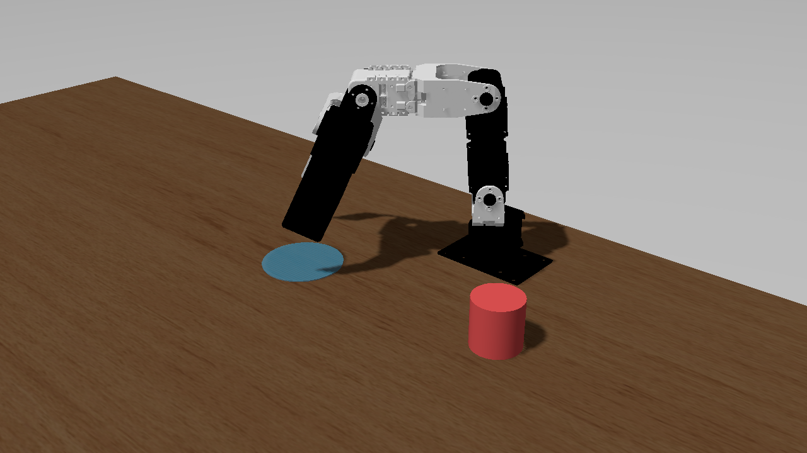
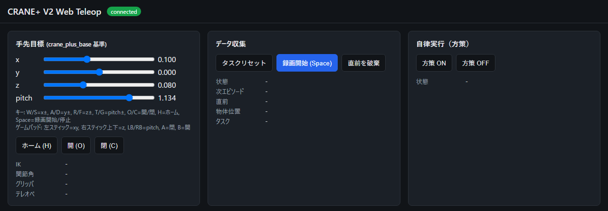
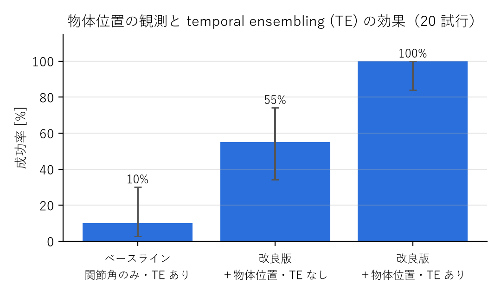
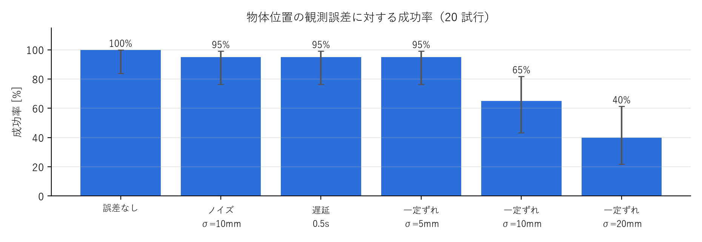
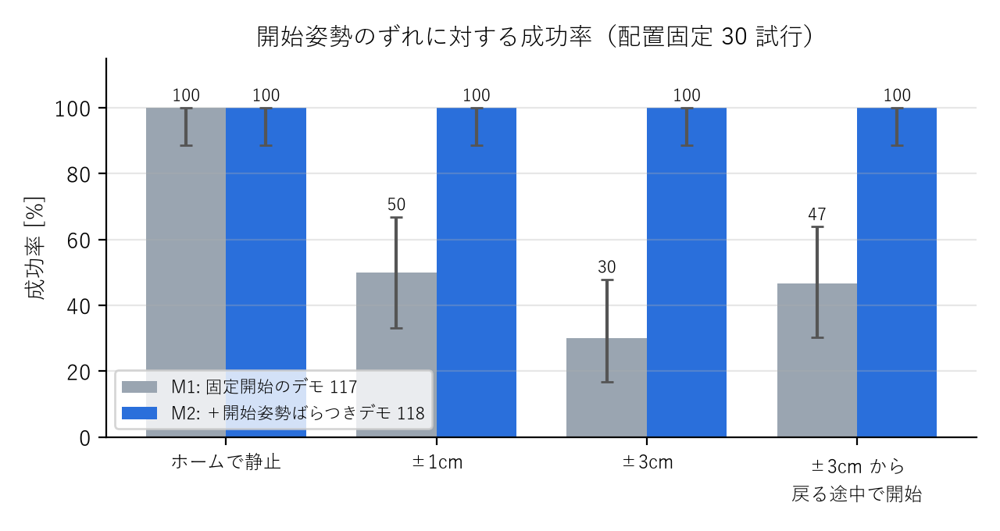

# CRANE+ V2 による把持・配置タスクの模倣学習

Physical AI 応用1講座 最終課題 説明資料 ／ omnicampus アカウント: ryokoe1010 
コード: https://github.com/ryota0051/pai-final-task-pick-place

## 1. 概要

Gazebo 上のロボットアーム CRANE+ V2 に、**机の上のランダムな位置に置かれた円柱（直径・高さ 4cm）を掴み、所定の置き場所（青い円）へ運ぶ**タスクを、
模倣学習（ACT: Action Chunking with Transformers）で学習させました。最終作品サンプルの[「知能ロボットシステムエンジニアリング 第5回 ROS 2入門（2/2）」](https://skinny-chord-c58.notion.site/5-ROS-2-2-2-2049a7a1061380fc8928e500eafc57d0)（以下、サンプル。関節キーボードでテレオペ → rosbag → LeRobotDataset → ACT → Gazebo で自律実行）をベースに、
観測・データ生成・推論・評価の各段階を改良しています。

サンプル: https://skinny-chord-c58.notion.site/5-ROS-2-2-2-2049a7a1061380fc8928e500eafc57d0

<figure><figcaption>図1 タスクの様子（赤: 物体、青: 置き場所）</figcaption></figure>

| | 成功率（ホームから開始） | 成功率（開始姿勢を ±3cm ずらす） |
|---|---|---|
| ベースライン（サンプルと同じ観測: 関節角のみ） | 10%（2/20） | - |
| 最終版（物体位置は真値） | **100%**（30/30） | **100%**（30/30） |
| 最終版（物体位置は**俯瞰カメラから推定**） | **100%**（30/30） | **97%**（29/30） |

成功の判定: 物体を 2cm 以上持ち上げたあと、置き場所の半径 3.5cm 以内の机の上に 0.5 秒以上静止。ベースライン以外は物体の配置を固定した同じ 30 か所で評価。

## 2. 目的

サンプルの方策は観測が関節角だけで、毎回同じ位置の物体に対して同じ動きを再生するものでした。物体の位置が変わると対応できません。
本課題では次の 2 点を目的にしました。

1. **物体の位置が毎回変わっても掴める方策**を作る
2. 成功率を**定量的に測り、失敗の原因を突き止めて改善できる仕組み**を作る（見た目で「動いた」で終わらせない）

## 3. システム構成

① デモ生成 <small>スクリプトデモ 235 回 （IK で軌道計画）</small>

→

② データセット化 <small>rosbag → LeRobotDataset 観測: 関節角＋物体位置</small>

→

③ ACT 学習 <small>GPU（RTX 4090） 60k step・約 1 時間</small>

→

④ 推論ノード <small>20Hz・temporal ensembling Gazebo へ関節指令</small>

| 構成要素 | 内容 |
|---|---|
| タスク環境（ROS 2 パッケージ） | 物体のランダム配置、成功判定、把持アシスト、俯瞰カメラでの物体位置推定、自動評価 |
| ブラウザ UI | 手先位置（xyz・pitch）での操作、録画、方策の ON/OFF |
| 学習・推論（サンプルの pai_training を fork） | 物体位置付きの変換、GPU 学習、推論ノード（rerun で予測を可視化） |
| 開発環境 | Docker（GPU 対応）。サンプルの Docker イメージをベースに再現可能に構築 |

## 4. 工夫した点

### 4.1 観測に物体位置を加え、物体をランダムに配置
エピソードごとに物体を作業範囲内のランダムな位置に置き、方策の観測に**物体位置（x, y, z）**を加えました。関節角だけのベースラインは成功率 10% で、
平均的な軌道を再生しているだけでした。

### 4.2 ブラウザでの手先操作（解析的逆運動学）
関節を 1 つずつ動かすサンプルのキーボード操作は直感的でないため、ブラウザから**手先の位置と傾き**を操作できる UI を作りました。
CRANE+ V2 のリンク寸法から閉形式の逆運動学を導き、手先目標を 20Hz で関節角に変換しています。

<figure><figcaption>図2 ブラウザ UI（手先操作・録画・方策の ON/OFF）</figcaption></figure>

### 4.3 スクリプトデモによる学習データの自動生成
条件をそろえた比較実験を繰り返すため、学習データは人の操作ではなく、物体位置から IK で軌道を計画する**スクリプトデモ**で自動生成しました。
人のテレオペと同じ経路（手先指令 → IK → 関節指令）で収録し、速度・経由点の高さ・把持位置・開始姿勢にばらつきを入れています（seed で再現可能）。

### 4.4 temporal ensembling で実行時の誤差の蓄積を抑制
学習データ上での予測誤差は小さいのに、実行すると把持位置が 1.5〜2.5cm ずれていました。毎ステップ予測した行動チャンク（0.75 秒分）の
先頭だけを実行していたため、誤差が蓄積していたことが原因です。重なった予測を指数重みで平均する temporal ensembling を推論時に入れただけで、
**再学習なしで成功率が 55% → 100%** になりました（図3）。

### 4.5 俯瞰カメラによる物体位置の推定
実機では物体位置の真値は得られないため、俯瞰カメラの画像（図4）から物体位置を推定しました（赤色画素の重心を机の高さの平面へ投影、誤差 1〜2mm）。
事前に「物体位置の観測がずれたら成功率はどう落ちるか」を測り（図5）、一定のずれは 5mm まで許容できることを確認してから導入しました。

<figure><figcaption>図3 物体位置の観測と temporal ensembling の効果</figcaption></figure>
<figure><figcaption>図4 俯瞰カメラの画像</figcaption></figure>

<figure><figcaption>図5 物体位置の観測誤差に対する成功率（ノイズ・遅延には強く、一定のずれに弱い）</figcaption></figure>

### 4.6 評価の仕組みと失敗原因の切り分け
成功率は自動評価で測り、Wilson の 95% 信頼区間を付けています。20 試行のランダム配置では当たり外れが大きかったため、
**物体の配置を固定した 30 か所**で条件を比べるようにしました。失敗時は関節角・指令・物体位置を rosbag に記録し、手先軌跡を復元して原因を調べます。

例: ロボット正面の物体でだけ失敗が続き、当初は方策の弱点を疑いました。しかし、同じ位置で条件を変えて試すと、**評価手順で腕がホームに戻りきる前に方策を開始していた**
ことが原因と分かりました。手順を直すと成功率は 80% → 100% になりました。

### 4.7 開始姿勢の弱点の発見と解消
上の経験から、「開始姿勢がずれたらどうなるか」をあえて評価したところ、**開始姿勢が 1cm ずれるだけで成功率が 50% に落ちる**弱点が見つかりました（図6）。
記録を見ると、上にずれて始めると空中でグリッパを閉じて置き場所へ向かうなど、方策が物体との位置関係ではなく「腕の姿勢と流れ」で作業の段階を判断していました。
学習データが毎回同じホーム姿勢から始まっていたためです。開始姿勢をばらつかせたデモを 118 回追加して学習し直すと、**±3cm のずれや、動いている途中からの開始でも 100%** になりました。

<figure><figcaption>図6 開始姿勢のずれに対する成功率（灰: 固定開始のデモのみ、青: 開始姿勢ばらつきデモを追加）</figcaption></figure>

## 5. 課題と今後

- **人のデモでの学習は未検証**: 学習データはすべてスクリプトデモです。人手デモの収録と混合学習、ブラウザ UI と関節キーボードの操作時間比較が残っています。
- **カメラ推定は簡易**: 赤色のしきい値処理で、「物体が赤い・照明が一定・カメラ位置が既知」というシミュレーションの前提に依存しています。
  今後は学習した物体検出器（ライセンスが Apache-2.0 の RT-DETRv2）と、色・照明・背景をランダムに変えた画像での学習で、実機に近い条件への頑健化を検討しています。
- **把持の物理を補助**: Gazebo では摩擦による把持が滑り落ちるため、グリッパが閉じ、物体が手先から 2cm 以内にあるときに物体を手先に固定する把持アシストを使っています。
  実機では把持の安定性を別途確認する必要があります。
- **データ量の交絡**: 開始姿勢ばらつきデモの追加ではデータ量も 2 倍になっています。過去にデータを 41 → 117 回に増やしても成功率は変わらなかったため、
  主因は開始姿勢の多様性と考えていますが、同数での比較は未実施です。
