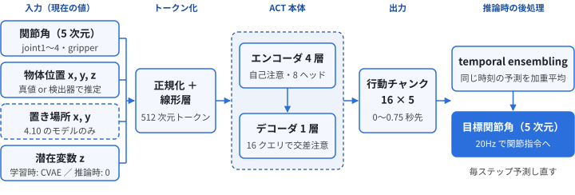
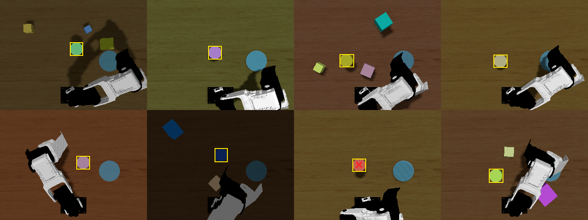
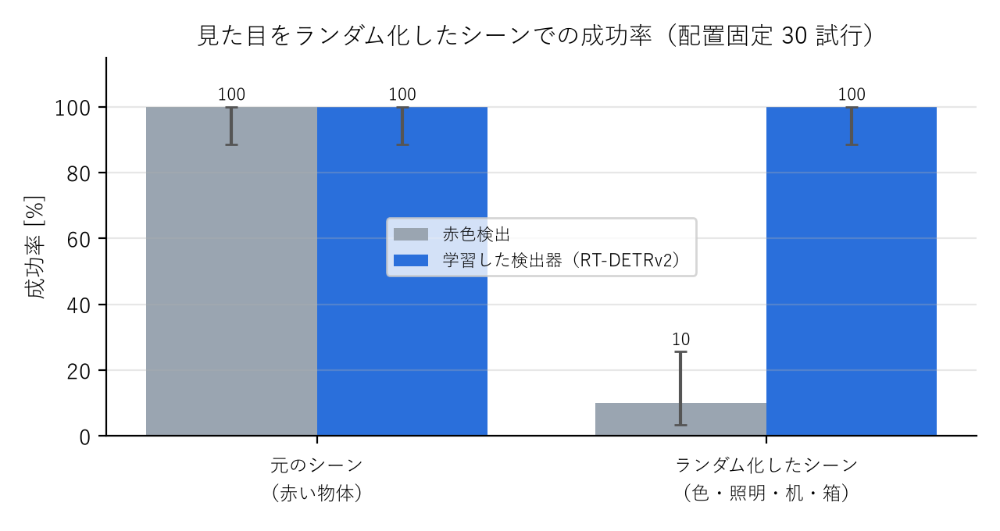
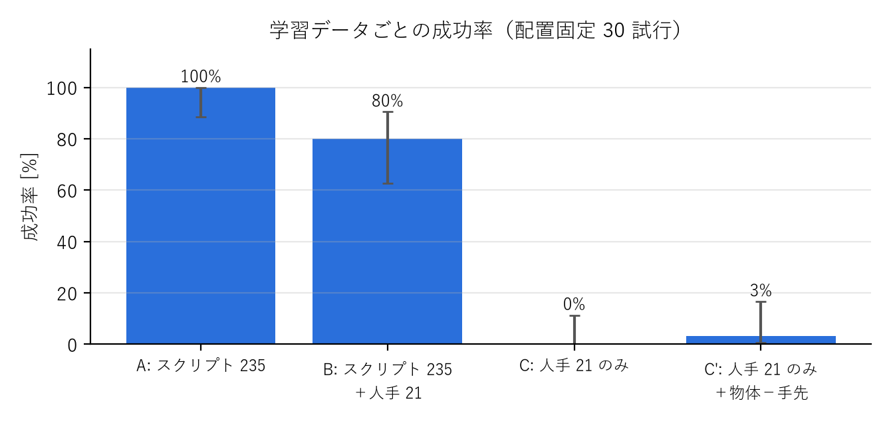
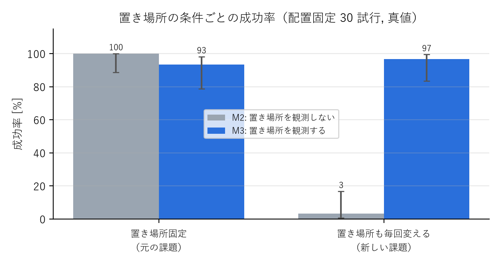
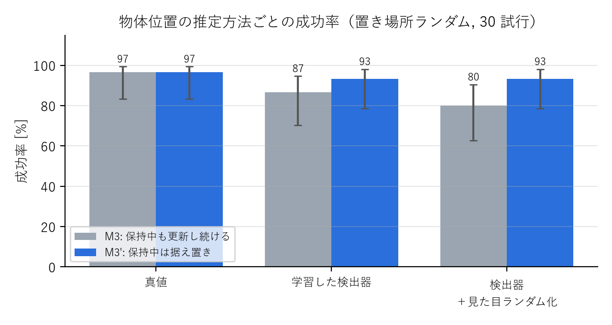
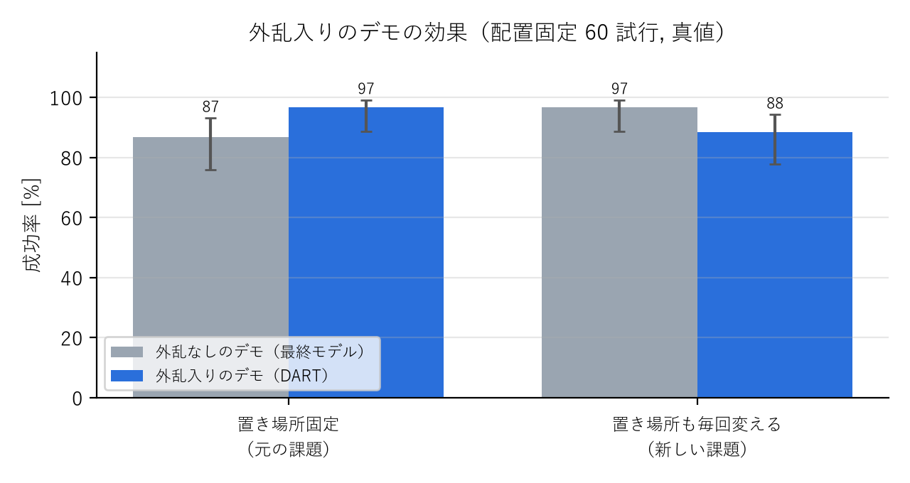
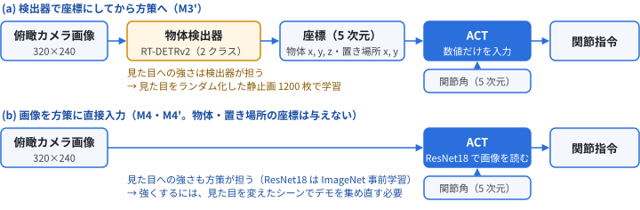
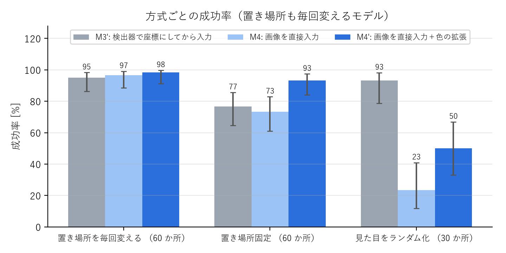

# CRANE+ V2 による把持・配置タスクの模倣学習

Physical AI 応用1講座 最終課題 説明資料 ／ omnicampus アカウント: ryokoe1010 
コード: https://github.com/ryota0051/pai-final-task-pick-place

## 1. 概要

Gazebo 上のロボットアーム CRANE+ V2 に、**机の上のランダムな位置に置かれた円柱（直径・高さ 4cm）を掴み、所定の置き場所（青い円）へ運ぶ**タスクを、
模倣学習（ACT: Action Chunking with Transformers）で学習させました。最終作品サンプルの[「知能ロボットシステムエンジニアリング 第5回 ROS 2入門（2/2）」](https://skinny-chord-c58.notion.site/5-ROS-2-2-2-2049a7a1061380fc8928e500eafc57d0)（以下、サンプル。関節キーボードでテレオペ → rosbag → LeRobotDataset → ACT → Gazebo で自律実行）をベースに、
観測・データ生成・推論・評価の各段階を改良しています。さらに追加実験として、置き場所の位置も毎回変え、物体と置き場所の両方をカメラで見て運ぶようにしました（4.10 節）。
最後に、カメラ画像を検出器で座標にしてから方策に入れる方式と、画像を方策に直接入れる方式を比べました（4.11 節）。

サンプル: https://skinny-chord-c58.notion.site/5-ROS-2-2-2-2049a7a1061380fc8928e500eafc57d0

<figure><figcaption>図1 タスクの様子（赤: 物体、青: 置き場所）</figcaption></figure>

| | 成功率（ホームから開始） | 成功率（開始姿勢を ±3cm ずらす） |
|---|---|---|
| M0 ベースライン（サンプルと同じ観測: 関節角のみ） | 10%（2/20） | - |
| M2 基本課題のモデル（物体位置は真値） | **100%**（30/30） | **100%**（30/30） |
| M2 基本課題のモデル（物体位置は**俯瞰カメラから推定**） | **100%**（30/30） | **97%**（29/30） |
| M2 基本課題のモデル（**学習した物体検出器**、物体の色・照明・机・ダミー物体を毎回変える） | **100%**（30/30） | - |
| M3' 追加実験: **置き場所も毎回変える**（物体と置き場所の両方を学習した検出器で推定、見た目も毎回変える） | **93%**（28/30） | - |
| M4' 追加実験: **画像を方策に直接入れる**（物体・置き場所の座標を与えない、置き場所も毎回変える） | **100%**（30/30） | - |

成功の判定: 物体を 2cm 以上持ち上げたあと、置き場所の半径 3.5cm 以内の机の上に 0.5 秒以上静止。M0〜M4' は 3 章のモデル一覧の記号。ベースライン以外は物体の配置を固定した同じ 30 か所で評価（置き場所も変える追加実験は、物体と置き場所の組を固定した 30 か所）。 
真値: Gazebo から直接取得した物体の正確な位置（実機では得られないため、4.5・4.8 でカメラ画像からの推定に置き換え）。

## 2. 目的

サンプルの方策は観測が関節角だけで、毎回同じ位置の物体に対して同じ動きを再生するものでした。物体の位置が変わると対応できません。
本課題では次の 2 点を目的にしました。

1. **物体の位置が毎回変わっても掴める方策**を作る
2. 成功率を**定量的に測り、失敗の原因を突き止めて改善できる仕組み**を作る

## 3. システム構成

① デモ生成 <small>スクリプトデモ 235 回 （IK で軌道計画）</small>

→

② データセット化 <small>rosbag → LeRobotDataset 観測: 関節角＋物体位置</small>

→

③ ACT 学習 <small>GPU（RTX 4090） 60k step・約 1 時間</small>

→

④ 推論ノード <small>20Hz・temporal ensembling Gazebo へ関節指令</small>

| 構成要素 | 内容 |
|---|---|
| タスク環境（ROS 2 パッケージ） | 物体のランダム配置、成功判定、把持アシスト、俯瞰カメラでの物体位置推定、自動評価 |
| ブラウザ UI | 手先位置（xyz・pitch）での操作、録画、方策の ON/OFF |
| 学習・推論（サンプルの pai_training を fork） | 物体位置付きの変換、GPU 学習、推論ノード（rerun で予測を可視化） |
| 開発環境 | Docker（GPU 対応）。サンプルの Docker イメージをベースに再現可能に構築 |

方策は LeRobot の ACT（設定はほぼ既定値）です。入力は現在の関節角と物体位置（4.10 では置き場所の位置も）の数値だけで、画像は直接入れません（カメラは物体位置の推定に使います）。4.11 では、比較のため画像を直接入れたモデルも作りました。
出力は 0.75 秒先までの 16 ステップ分の目標関節角（行動チャンク）です。推論時は 20Hz で毎ステップ予測し直し、重なった予測を temporal ensembling（4.4）で平均して関節指令にします（図2）。

<figure><figcaption>図2 方策（ACT）の入力と出力（破線の入力は M3・M3' のみ。z は学習時のみ CVAE で求め、推論時は 0）</figcaption></figure>

**モデル一覧**: 本資料で比べるモデルです。以降は記号で呼びます。どれも方策は ACT で、学習データはスクリプトデモ（4.3）です。

| 記号 | 呼び名 | 方策の入力（観測） | 学習データ | 出てくる節 |
|---|---|---|---|---|
| M0 | ベースライン | 関節角のみ（サンプルと同じ） | 固定開始 117 本 | 1、4.1、4.4 |
| M1 | 物体位置を観測 | 関節角＋物体位置 | 固定開始 117 本 | 4.4〜4.7 |
| M2 | **基本課題のモデル** | 関節角＋物体位置 | 固定開始 117 本＋開始姿勢ばらつき 118 本 | 1、4.5、4.7〜4.10 |
| M3 | 置き場所ランダムのモデル | 関節角＋物体位置＋置き場所 | 置き場所も毎回変えた 339 本 | 4.10 |
| M3' | 〃（保持中の物体位置を据え置き） | M3 と同じ。ただし物体を保持している間（グリッパが閉じている間）は、物体位置を閉じる直前の値のまま更新しない | M3 と同じ 339 本 | 1、4.10、4.11 |
| M4 | 画像入力のモデル | 関節角＋俯瞰カメラ画像（座標なし） | 置き場所も毎回変えた画像つき 346 本 | 4.11 |
| M4' | 〃（色の拡張） | M4 と同じ（学習時に画像の色をランダムに変える） | M4 と同じ 346 本 | 1、4.11 |

M0〜M3' は、学習したモデルはそのままで、物体位置（・置き場所）の入力を真値・俯瞰カメラの赤色検出・学習した検出器に差し替えて評価しています。
4.9 では M2 の学習データを人手デモに変えた変種、4.10 では M3' の学習データを倍の 701 本にした変種と外乱入りの 343 本（DART）の変種も使います。

## 4. 工夫した点

### 4.1 観測に物体位置を加え、物体をランダムに配置

使うモデル: M0・M1（3 章のモデル一覧）

エピソードごとに物体を作業範囲内のランダムな位置に置き、方策の観測に**物体位置（x, y, z）**を加えました。関節角だけのベースラインは成功率 10% で、
平均的な軌道を再生しているだけでした。

### 4.2 ブラウザでの手先操作
関節を 1 つずつ動かすサンプルのキーボード操作は直感的でないため、ブラウザから**手先の位置と傾き**を操作できる UI を作りました。

<figure><figcaption>図3 ブラウザ UI（手先操作・録画・方策の ON/OFF）</figcaption></figure>

### 4.3 スクリプトデモによる学習データの自動生成
条件をそろえた比較実験を繰り返すため、学習データは人の操作ではなく、物体位置から IK で軌道を計画する**スクリプトデモ**で自動生成しました。
人のテレオペと同じ経路（手先指令 → IK → 関節指令）で収録し、速度・経由点の高さ・把持位置・開始姿勢にばらつきを入れています（seed で再現可能）。

### 4.4 temporal ensembling で実行時の誤差の蓄積を抑制

使うモデル: M0・M1（3 章のモデル一覧）

学習データ上での予測誤差は小さいのに、実行すると把持位置が 1.5〜2.5cm ずれていました。毎ステップ予測した行動チャンク（0.75 秒分）の
先頭だけを実行していたため、誤差が蓄積していたことが原因です。重なった予測を指数重みで平均する temporal ensembling を推論時に入れただけで、
**再学習なしで成功率が 55% → 100%** になりました（図4）。

### 4.5 俯瞰カメラによる物体位置の推定

使うモデル: M1（観測誤差の評価）・M2（俯瞰カメラでの成功率）（3 章のモデル一覧）

実機では物体位置の真値は得られないため、俯瞰カメラの画像（図5）から物体位置を推定しました（赤色画素の重心を机の高さの平面へ投影、誤差 1〜2mm）。
事前に「物体位置の観測がずれたら成功率はどう落ちるか」を測り（図6）、一定のずれは 5mm まで許容できることを確認してから導入しました。

<figure><figcaption>図4 物体位置の観測と temporal ensembling の効果</figcaption></figure>
<figure><figcaption>図5 俯瞰カメラの画像</figcaption></figure>

<figure><figcaption>図6 物体位置の観測誤差に対する成功率（ノイズ・遅延には強く、一定のずれに弱い）</figcaption></figure>

### 4.6 評価の仕組みと失敗原因の切り分け

使うモデル: M1（3 章のモデル一覧）

成功率は自動評価で測り、Wilson の 95% 信頼区間を付けています。20 試行のランダム配置では当たり外れが大きかったため、
**物体の配置を固定した 30 か所**で条件を比べるようにしました。失敗時は関節角・指令・物体位置を rosbag に記録し、手先軌跡を復元して原因を調べます。

例: ロボット正面の物体でだけ失敗が続き、当初は方策の弱点を疑いました。しかし、同じ位置で条件を変えて試すと、**評価手順で腕がホームに戻りきる前に方策を開始していた**
ことが原因と分かりました。手順を直すと成功率は 80% → 100% になりました。

### 4.7 開始姿勢の弱点の発見と解消

使うモデル: M1 → M2（3 章のモデル一覧）

上の経験から、「開始姿勢がずれたらどうなるか」をあえて評価したところ、**開始姿勢が 1cm ずれるだけで成功率が 50% に落ちる**弱点が見つかりました（図7）。
記録を見ると、上にずれて始めると空中でグリッパを閉じて置き場所へ向かうなど、方策が物体との位置関係ではなく「腕の姿勢と流れ」で作業の段階を判断していました。
学習データが毎回同じホーム姿勢から始まっていたためです。開始姿勢をばらつかせたデモを 118 回追加して学習し直すと（M2）、**±3cm のずれや、動いている途中からの開始でも 100%** になりました。

<figure><figcaption>図7 開始姿勢のずれに対する成功率（灰: M1＝固定開始のデモのみ、青: M2＝開始姿勢ばらつきデモを追加）</figcaption></figure>

### 4.8 見た目の変化に強い物体検出器（ドメインランダム化）

使うモデル: M2（物体位置の入力を検出器に差し替え）（3 章のモデル一覧）

4.5 の赤色検出は「物体が赤い・照明が一定」という前提に頼っており、物体の色や照明が変わると成功率が 3% まで落ちました。
実機に近い条件に対応するため、学習した物体検出器に置き換えました。

- **学習データの自動生成**: Gazebo で物体の色・机の色味・照明の明るさと向き・ダミーの箱（0〜3 個）・腕の姿勢を毎回ランダムに変え（ドメインランダム化）、
  俯瞰カメラの画像を 1200 枚撮影しました。正解の枠は物体の真の位置と円柱の形をカメラモデルで投影して自動で付けるので、手作業のラベル付けは不要です。
- **モデル**: 商用でも制約の少ない Apache-2.0 ライセンスの **RT-DETRv2**（COCO 事前学習済み）を 1 クラスで追加学習しました（RTX 4090 で約 13 分）。
  AGPL の Ultralytics（YOLO）はライセンスを考慮して避けました。
- **位置の計算**: 枠の中心から、斜めに見える円柱の側面の分を幾何的に補正して物体の中心位置を求めます。方策（ACT）は再学習せず、物体位置の入力を差し替えるだけです。

学習に使っていない画像 300 枚で、すべての物体を検出し位置誤差は平均 0.28mm でした（赤色検出は 9 枚しか検出できず）。
見た目をランダムに変えたシーンでの成功率は、**赤色検出の 3% に対して 100%** で、元のシーンでも 100% を保ちました（図9）。

<figure><figcaption>図8 見た目をランダム化した評価画像での検出例（黄枠: 学習した検出器、赤×: 赤色検出。赤色検出は赤い物体しか見つけられない）</figcaption></figure>
<figure><figcaption>図9 物体位置の推定方法ごとの成功率（灰: 赤色検出、青: 学習した検出器）</figcaption></figure>

### 4.9 人の操作によるデモでの学習

使うモデル: M2 と、その学習データを人手デモに変えた変種（3 章のモデル一覧）

ブラウザ UI（4.2）で人が操作したデモを 21 本収録し（31 回中、成功した 21 回）、スクリプトデモと比べました。
人は物体の真上で位置を細かく合わせてから掴むため、掴むまでの時間はスクリプトの約 7 倍で、合わせる時間も回ごとにばらばらでした。

| | 動いている時間 | 掴むまで |
|---|---|---|
| 人手デモ 21 本 | 平均 23.7 秒（16.5〜38.2） | 平均 13.0 秒 |
| スクリプトデモ 235 本 | 平均 9.6 秒 | 平均 1.9 秒 |

同じ条件（配置固定 30 か所、ホームで静止から開始、制限時間 60 秒）で比べると、人手デモを混ぜると成功率は 100% → 80% に下がり、
人手デモだけでは 0% でした（図10）。人手デモだけの方策は物体の真上（高さ 8cm）まで動いて止まり、下ろしません。
「手先が物体に十分近いか」が分からないためと考え、観測に物体と手先の相対位置を加えましたが、3% にしか改善しませんでした。

**考察**: デモでは同じ状況で「止まって合わせる」と「下ろす」の両方の行動があり、止まる長さも回ごとに違います。
模倣学習では、こうした**一貫しない行動が「いつ次の段階に移るか」の判断を難しくする**と考えられ、本数（21 本）の少なさも重なっています。
スクリプトデモで高い成功率が出たのは、量だけでなく行動が一貫していたためでもあります。人手デモを生かすには、止まっている区間を除く、
真上に来たら迷わず下ろすよう操作をそろえる、本数を増やす、といった工夫が必要です。

<figure><figcaption>図10 学習データごとの成功率（A: スクリプトのみ＝M2、B: ＋人手、C: 人手のみ、C': 人手のみ＋物体と手先の相対位置）</figcaption></figure>

### 4.10 置き場所も毎回変える（追加実験）

使うモデル: M2・M3・M3'（と M3' の変種）（3 章のモデル一覧）

ここまでの方策は置き場所が固定で、「いつも同じ場所へ運ぶ」動きを覚えていただけでした。そこで置き場所もエピソードごとにランダムに変え、
方策の観測に**置き場所の位置（x, y）**を加えました。物体検出器も**物体と置き場所の 2 クラス**に拡張し（置き場所の色もランダム化）、
スクリプトデモ 339 本で学習し直しました。

置き場所を観測しない元のモデル（M2）は、置き場所が変わると固定位置へ運んでしまい成功率 3% でした。新しいモデル（M3）は 97% で、
置き場所固定の元の課題では 93% でした（図11）。ただし後述の M3'（同じ 30 か所では M3 と同じ成績）を別の 30 か所でも評価すると 80%（24/30）で、合わせて 87%（52/60）でした。
元のモデルは同じ 60 か所すべてで成功しており（60/60）、この差は有意です（Fisher の正確検定 p≈0.006）。失敗はすべて左側（y > 0）の物体を持ち上げられないものでした。置き場所が毎回変わって課題が難しくなった分、
固定位置へ運ぶ例が学習データのごく一部になり、掴む精度が下がったと考えています。

<figure><figcaption>図11 置き場所の条件ごとの成功率（灰: M2＝置き場所を観測しない、青: M3＝置き場所を観測する）</figcaption></figure>

**検出器で動かしたときの失敗と対策**: 学習した検出器の推定値で動かすと、真値より成功率が下がりました（97% → 87%、見た目ランダム化で 80%）。
推定値と真値を記録して調べると、**掴んだ瞬間に物体の推定値が間違った位置へ飛び、そのまま残っていました**（誤差 0.3mm → 100mm）。
掴むとグリッパが真上から物体を隠すためです。方策は真値で学習しているので、運搬中の物体位置は手と一緒に動くものと覚えており、
「物体が離れた所に残っている」観測を見て止まっていました。そこで**物体を保持している間（グリッパが閉じている間）は、物体位置の観測を閉じる直前の値のまま据え置く**ようにし、
学習データにも同じ規則を当てはめて学習し直しました（M3'）（運搬中の物体の位置は手先から分かるので、据え置いても困りません）。
これで検出器でも 93%、見た目をランダム化しても 93% になりました（図12）。

<figure><figcaption>図12 物体位置の推定方法ごとの成功率（灰: M3＝保持中も物体位置を更新し続ける、青: M3'＝保持中の物体位置を据え置き）</figcaption></figure>

**残る失敗の分析**: 残る失敗（置き場所を毎回変える課題で 30 回中 1〜2 回、置き場所固定では多いと 6 回）は、すべて「持ち上げられない」ものです。記録を見ると、方策が狙う手先の位置が物体から数 mm ずれ、
さらに腕が指令に 2〜3cm 遅れて下がるため、グリッパを閉じ始めるときに指が物体の上面に乗っていました。デモを倍の 701 本にしても、
推論時の設定を変えても成功率は変わらず、失敗する場所が入れ替わるだけだったため、掴む動作の精度に余裕がないことが原因と考えています。

**外乱入りのデモ（DART）**: スクリプトデモは計画どおりの軌道しか含まないため、「ずれた状態から物体の真上へ戻す」例がありません。
そこで DART（Laskey et al., 2017）にならい、デモの収録時に**実際に動かす手先の目標にだけ最大 1cm の外乱を加え、学習のラベルには外乱なしの指令を使う**ようにしました。
外乱は物体へ近づいて下ろす区間だけに入れ、閉じる前に 0 に戻します。同じ本数（343 本）で学習し直すと、置き場所固定では 87% → 97%（58/60）に上がり、
左側の失敗はほぼ消えました。一方、置き場所を毎回変える課題では 97% → 88%（53/60）に下がり、正面の奥寄りで失敗が増えました（図13）。
合計は 110/120 と 111/120 で変わらず、どちらの差も有意ではありません。失敗する場所が移っただけで、掴む精度の余裕は増えませんでした。

<figure><figcaption>図13 外乱入りのデモの効果（灰: M3'＝外乱なしのデモ、青: M3' と同じ観測で外乱入りのデモ（DART）。物体と置き場所の組を固定した 60 か所）</figcaption></figure>

### 4.11 画像を方策に直接入れる（追加実験）

使うモデル: M3'・M4・M4'（3 章のモデル一覧）

4.10 までの方策は、カメラ画像を検出器で物体・置き場所の座標（数値）にしてから受け取っていました。これと、**画像を方策に直接入れ、座標を一切与えない**方式（M4・M4'）を比べました（図14）。
ACT は画像を ImageNet で事前学習した ResNet18 で読み込み、関節角とあわせて行動を出力します。学習データは 4.10 と同じ条件・seed のスクリプトデモを
俯瞰カメラの画像つきで収録し直した 346 本で、学習は同じ 80k step です。

<figure><figcaption>図14 カメラ画像を方策に渡す 2 つの方式（(a) 検出器で座標にしてから入力＝M3'、(b) 画像を直接入力＝M4・M4'）</figcaption></figure>

- **置き場所を毎回変える課題**では、座標を与えなくても検出器経由と同等に運べました（検出器経由 95%、画像直接 97%）。
- **置き場所固定の元の課題**（置き場所は範囲の右奥の角）では、画像直接は 73% に下がりました。物体の真上までは行くのに高さ 4.4cm でグリッパを閉じて掴み損ねており、
  置き場所を左右反転したり数 cm 内側にずらすと、同じ物体位置で成功しました。範囲の角の置き場所と左寄りの物体の組み合わせは、ランダムに集めたデモ 346 本に 1〜2 本しかなく、
  そこを補間できていないと考えています（検出器経由の失敗も同じ左寄りの配置に集まっています）。
  学習時に画像の**明るさ・コントラスト・彩度・色相をランダムに変える拡張**を入れると（M4'）93% に上がり、検出器経由（77%）を上回りました（Fisher の正確検定 p≈0.02）。
  色や明るさの細かい見え方に頼っていたことが、崩れの一因だったと考えられます。
- **見た目をランダム化したシーン**では、画像直接は 23%（色の拡張ありで 50%）にとどまり、検出器経由（93%）に及びませんでした。
  ただしこの差には学習データの違いも含まれます。検出器は見た目をランダム化した静止画で学習していますが、画像直接の方策は元の見た目のデモだけで学習しています。

画像を直接入れる方式は、座標の設計や検出器がなくても学習データの範囲内では同等に動きます。一方で、見た目への強さも方策自身が学ぶ必要があり、
強くするには見た目を変えたシーンでデモ（ロボットの動作）を集め直す必要があります。検出器を挟む方式では、それが静止画の収集だけで済みます。
今回は同じデモで学習した場合の比較として、見た目への対策はあえて加えていません。

<figure><figcaption>図15 方式ごとの成功率（灰: M3'＝検出器経由、水色: M4＝画像を直接入力、青: M4'＝画像を直接入力＋色の拡張。物体と置き場所の組を固定した 60 か所、見た目のランダム化は 30 か所）</figcaption></figure>

## 5. 課題と今後

- **人のデモでは学習できていない**: 人手デモ 21 本では成功せず、混ぜると成功率が下がりました（4.9）。操作の一貫性をそろえたデモでの再検証が残っています。
- **物体検出器はシミュレーション画像だけで学習**: 見た目の変化には強くなりましたが、実機の画像での動作は未確認です。
  シミュレーションでは正解の枠が正確で輪郭もくっきりしているため、0.28mm という精度は実機では期待できません。また、カメラの取り付け位置は既知としています。
- **掴む動作のアシスト**: Gazebo では指の摩擦だけで掴んだ物体が滑り落ちるため、グリッパが閉じ、物体が手先から 2cm 以内にあるときに物体を手先に固定するアシストを使っています。
  実機では把持の安定性を別途確認する必要があります。
- **データ量の交絡**: 開始姿勢ばらつきデモの追加ではデータ量も 2 倍になっています。過去にデータを 41 → 117 回に増やしても成功率は変わらなかったため、
  主因は開始姿勢の多様性と考えていますが、同数での比較は未実施です。
- **掴む精度に余裕がない（追加実験）**: 30 回中 1〜6 回、狙いが数 mm ずれて指が物体の上面に乗り、掴み損ねます。
  腕は指令に遅れて追従し（関節の追従誤差もあり）、目標に着く前にグリッパを閉じ始める動きをデモから学んでいることも影響しています。
  デモを倍にしても、外乱入りのデモ（DART）にしても、失敗する場所が移るだけでした。掴む直前に止まって位置を合わせる動きをデモに入れる、
  関節の追従を改善する、行動を物体から見た手先の位置で表す、などが次の候補です。
  また、置き場所固定の元の課題では、置き場所を観測するモデルの成功率が 87%（52/60）と、元のモデルの 100%（60/60）より下がっています。
- **画像を直接入れる方式の見た目への弱さ（追加実験）**: 見た目をランダム化したシーンでは 50% にとどまります。見た目を変えたシーンでのデモの収集が次の候補です。
  また、置き場所の範囲の角のように物体と置き場所の組み合わせが学習データで薄い配置では、方式によらず失敗が集まります。
  収録時の置き場所の選び方を工夫する案も試算しましたが、この範囲（腕が届く細い帯）では角の付近の例を 3 割ほどしか増やせず、範囲の内側の例が減るため見送りました。
